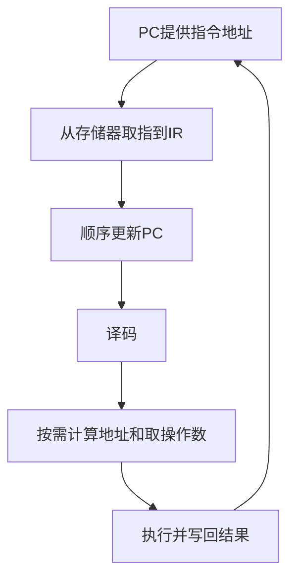

# 指令执行过程

来源：原图04—05、07。返回 [[第一章 计算机系统概述]]。

## 简化取数指令示例
约定：单地址累加器机器，直接寻址；一条指令占一个编址单元；执行的是将内存操作数送入ACC的LOAD指令。`(R)`表示寄存器R中的内容，`M[a]`表示地址a的存储内容。

```text
取指：
(PC) → MAR
M[MAR] → MDR
(MDR) → IR
(PC) + 1 → PC

译码：
OP(IR) → CU的译码/控制逻辑

执行LOAD：
AD(IR) → MAR
M[MAR] → MDR
(MDR) → ACC
```

访存时还需要控制器发出读控制、等待存储器响应等，上面省略这些控制细节；并非通用CPU逐拍的完整微操作表。



## 必须分清
1. 指令是完整编码，操作码只是其中说明操作类型的字段；地址码是另一类字段。
2. 图中两次读存储器，第一次取得指令送IR，第二次取得操作数送ACC。相同比特模式的含义由所处阶段和使用方式决定。
3. “单地址指令默认另一个操作数是ACC”只适用于相应累加器型指令系统，不能推广到全部ISA。
4. `PC+1`取决于前述约定。按字节编址、定长32位指令，顺序地址通常加4；变长指令按实际长度增加，转移指令可写入目标地址。
5. 取指—译码—执行是概念模型；实际机器可能流水、并行和乱序执行。

原图04中的地址5及原图05中的ACC=2属于特定例子，照片未提供完整内存初值，不能独立核验，未作为通用结论。

## 外部参考
[RISC-V官方指令集手册：指令长度](https://docs.riscv.org/reference/isa/v20240411/unpriv/intro.html)：基础指令32位，同时允许16位等扩展编码，说明指令长度须看ISA约定。

关联：[[运算器与控制器]]、[[主存储器与容量计算]]、[[软件语言与系统层次]]。
