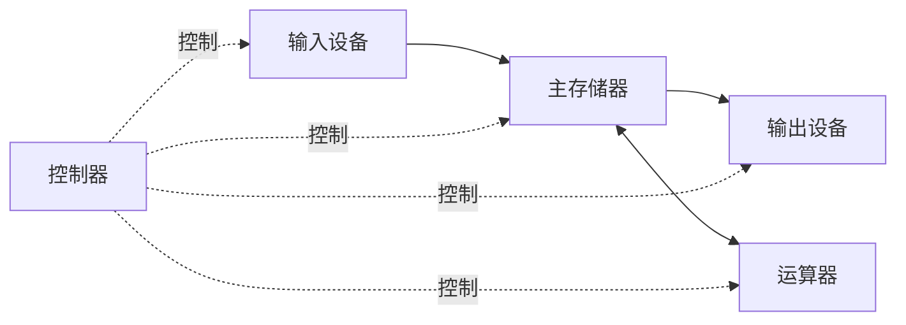

# 计算机系统与冯诺依曼结构

来源：原图01—02。返回 [[第一章 计算机系统概述]]。

## 系统组成
计算机系统由硬件和软件共同组成。硬件是物理装置，软件包括程序及相关数据、文档等。性能受软硬件及其配合共同影响。

二进制的一位称为bit；常见数字电路用不同电平区间表示逻辑0、1，并非在所有电路中都必然“高电平=1”。

## 存储程序思想
将程序和数据预先存入存储器，机器自动取出并执行指令。通常按顺序执行，遇到转移等指令可改变执行顺序。

经典冯诺依曼计算机的教材特征：
- 运算器、控制器、存储器、输入设备、输出设备五大部件。
- 指令和数据都用二进制表示，通常存入同一存储器，可按地址访问。
- 指令一般包括操作码与地址码等字段。
- 采用存储程序工作方式。
- 早期结构以运算器为中心。

现代计算机教材框图通常强调以存储器为中心，避免大量输入输出数据均经运算器中转。它仍可遵循存储程序思想；实际I/O还可能采用DMA等机制。

## 部件划分
- CPU：主要由运算器和控制器构成，内部还包含寄存器等。
- 主机：教材中通常指CPU与主存储器。
- 外设：输入输出设备及辅助存储设备等。
- 存储器：包括主存与辅存，不能把全部存储器都划入主机。

硬件与软件在实现某些逻辑功能上可以相互替代，但性能、成本、功耗和灵活性取决于具体实现，不宜绝对化。

关联：[[运算器与控制器]]、[[主存储器与容量计算]]、[[软件语言与系统层次]]。
