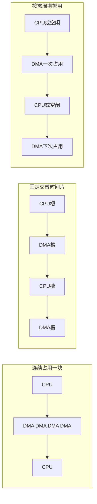
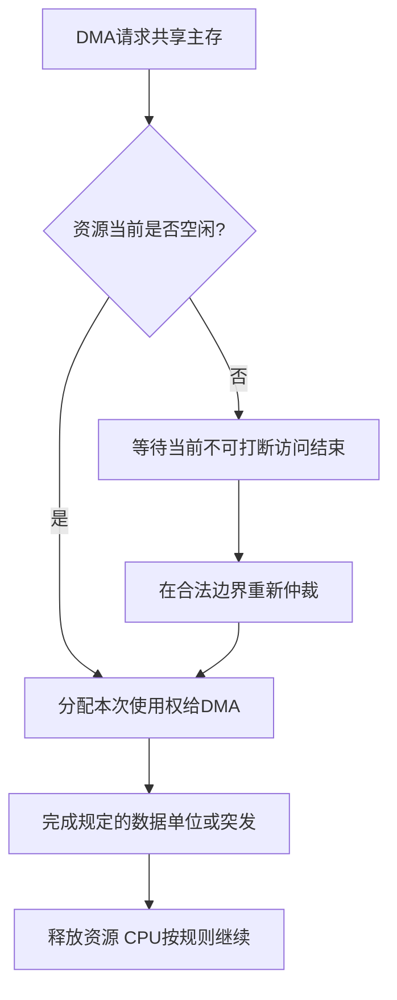

# DMA传送方式与访存仲裁

返回 [[第七章 输入输出系统]]。来源：[[第七章原图与识别说明#原图05|原图05]]、[[第七章原图与识别说明#原图08|原图08]]、[[第七章原图与识别说明#原图14|原图14]]。

## 为什么要仲裁
在传统共享主存/总线模型中，CPU和DMA不能同时占用同一独占资源，因此需要决定谁何时访存。DMA不是CPU需要先执行一段逐字搬运程序的普通中断。

教材常把外部中断响应放在指令结束，而允许DMA请求在合适的存取周期边界获得资源。具体机器还受不可中断总线事务、锁定及仲裁规则约束，不是任意半拍都可夺走CPU正在使用的总线。

## 三种传送方式
### 停止CPU访问主存
DMA获得使用权后，连续占用主存/总线，直到一个块或本次规定任务完成再释放。控制较简单；简单教材CPU可能停顿，主存空档不能被CPU充分利用。

这里强调停止共享主存访问，不把所有现代CPU内部执行一律判为完全停止。

### DMA与CPU交替访问
把可用访存时间划分给CPU与DMA交替使用，照片记为C1、C2。可减少每次动态申请、归还的仲裁开销，但需要匹配两者的时序及设备就绪，硬件与调度有额外要求。

照片写“DMA与主存交替访问”不准确，交替使用主存的主体应为**DMA和CPU**。C1/C2是此模型的访存时间片，不等于每条CPU指令固定分成两个完整指令周期。

### 周期挪用/周期窃取
DMA有需求时申请一个或少量规定的访存占用，传完后释放；其余时间允许CPU使用。照片按“每个字后释放”描述典型逐字模型；实际也可能按突发粒度仲裁。

## 补充图：共享资源分配的三种形态

方框宽度不表示等长时间；图示的是分配次序。

## 周期挪用时CPU的三种状态
1. CPU不需要该共享资源：DMA可利用空档，不必造成CPU访存等待。
2. CPU正在进行不可打断的一次访存：待当前允许释放的边界后再切换。
3. CPU与DMA同时请求：按仲裁规则选择。教材常给DMA较高优先级以满足外设服务期限；实际策略可能轮转或给CPU优先，不能当普遍硬件规则。

## 补充流程图：按教材DMA优先的仲裁模型

图采用本课优先规则，省略多个DMA主设备间的进一步判优。主存访问总时间、CPU受阻时间和CPU执行指令时间要分别计算；只有DMA挪用了CPU原本需要的槽位，才产生相应等待。

参考：[ST AN2548](https://www.st.com/resource/en/application_note/cd00160362.pdf)给出具体芯片的总线矩阵和仲裁示例，说明不同平台并不统一采用“DMA绝对优先”。

关联：[[总线传输过程与使用权]]、[[总线周期频率与带宽]]、[[DMA控制器与传送过程]]、[[中断优先级与屏蔽字]]。
