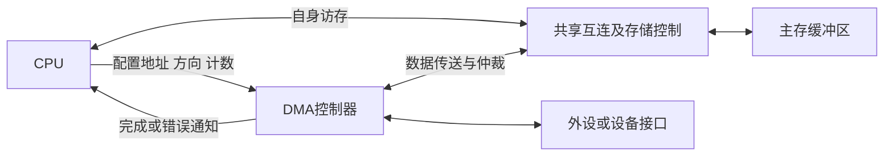
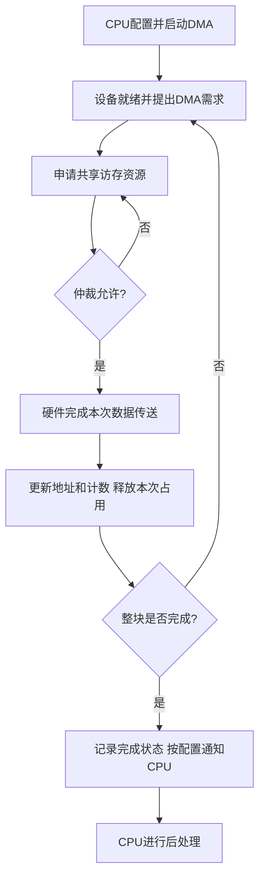

# DMA控制器与传送过程

返回 [[第七章 输入输出系统]]。来源：[[第七章原图与识别说明#原图04|原图04]]、[[第七章原图与识别说明#原图05|原图05]]、[[第七章原图与识别说明#原图06|原图06]]、[[第七章原图与识别说明#原图08|原图08]]、[[第七章原图与识别说明#原图14|原图14]]。

## DMA直接存储器访问
DMA让外设与主存间的数据搬运不必逐字经CPU寄存器由CPU指令完成。DMA控制器是具有相应传送/主控能力的硬件，可能集成到设备或系统芯片中。

“直接数据通路”是功能含义，不保证每台机器都有一组叫DMA总线的专用导线，也不代表完全绕过缓冲、总线、桥或存储控制器。

## 典型寄存器和功能
照片的教材记号：AR为主存地址，DAR为设备地址，WC为计数；还需方向、模式、状态等。实际名称、地址增减、计数递减/递增规则按控制器定义。

控制器接收或生成传送需求、申请传输资源、形成地址和读写控制、搬运数据、更新地址与计数，并报告完成或错误。不能把“外设准备好一个字”理解为所有DMA的唯一请求粒度。

## 补充结构图：CPU配置、DMA搬运

## 预处理、传送、后处理
1. CPU准备内存缓冲区，设置方向、主存起始地址、设备地址/端口、数量及模式，按规定启动。
2. DMA根据就绪情况申请资源；获准后硬件搬运并更新计数。CPU可在不受同一资源冲突阻塞时继续其他工作。
3. 达到传送终止条件后结束。常用完成中断通知CPU，由软件检查状态、处理数据或发起下一次传送；也可采用状态查询等通知机制。

## 补充流程图：按教材逐字周期挪用模型

这是成功路径示意；错误/超时需按控制器规则处理。连续块传送可能持续持有资源，不套用这里每字释放的分支。

## 需要限制的说法
- DMA减少逐字搬运的软件负担，不是CPU全程零参与。
- 完成中断不等于“DMA就是程序中断传送”；DMA期间不需CPU逐字执行ISR。
- CPU与DMA可能并行，但共享内存和总线仍可能竞争，CPU不保证始终不受影响。
- 单共享总线模型中DMA取得使用权时，CPU不能同时驱动同一总线；不能推广成整个DMA任务期间CPU完全停机。
- 一个数据单位的传送耗时依通路和协议，不普遍等于一个主存存取周期。

参考：[ST AN2548：DMA与CPU共享互连](https://www.st.com/resource/en/application_note/cd00160362.pdf)。

关联：[[DMA传送方式与访存仲裁]]、[[IO查询开销与中断开销计算]]、[[系统总线结构与桥接]]、[[主存与CPU连接及容量扩展]]。
