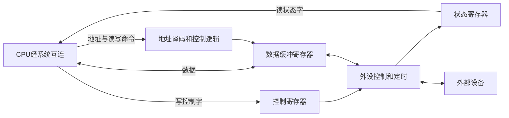

# IO接口功能与寄存器

返回 [[第七章 输入输出系统]]。来源：[[第七章原图与识别说明#原图01|原图01]]、[[第七章原图与识别说明#原图09|原图09]]、[[第七章原图与识别说明#原图12|原图12]]、[[第七章原图与识别说明#原图13|原图13]]。

## 接口和端口
I/O接口/控制器是协调主机和外设的硬件逻辑；可实现为独立芯片，也可集成到其他芯片内。照片所画“总线—控制器—外设”是功能模型，不代表总是一块单独控制芯片。

I/O端口通常指可被CPU寻址访问的接口寄存器或访问位置；本章的port不等于USB插口等物理连接器。

## 三类寄存器
- 数据缓冲寄存器DBR：暂存输入或输出数据，缓和速度差异，但容量有限，不能保证任意速度下永不溢出。
- 状态寄存器：保存就绪、忙、错误等状态，供CPU读取和判断。
- 控制寄存器：接收启动、复位、方向、中断允许等控制字。

有的实现中读状态、写控制使用同一地址、不同读写语义，不必是三个独立物理寄存器。不得推断所有设备都可把状态和控制合并。

## 接口的主要功能
数据缓冲、状态反馈和错误检测、控制与定时，以及需要时的串并转换或其他格式转换。串并转换不是每个接口必有功能。

## 补充图：接口内部的功能组成

这是功能关系图，不表示每个框都有独立引脚。控制字/状态字的内容通常经**数据通路**传送；读写选通、请求与应答等控制事件由相应控制信号或协议承载，不能把“控制字”与“控制线”混为一谈。

## 常见软件操作
1. 写控制端口：发命令。
2. 读状态端口：检查就绪、完成或错误。
3. 读/写数据端口：取得输入数据或交付输出数据。

## 接口分类的不同维度
按外设侧传送形式可分串行/并行；按主机控制方式可支持查询、中断、DMA；按配置能力可分可编程/不可编程。这些维度可以交叉，一个控制器也可支持多种控制方式。

关联：[[IO端口编址与IN OUT指令]]、[[总线基础分类与信号]]、[[总线复用与串并行比较]]。
