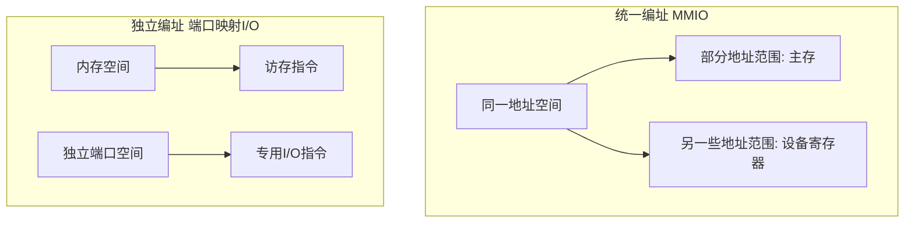

# IO端口编址与IN OUT指令

返回 [[第七章 输入输出系统]]。来源：[[第七章原图与识别说明#原图08|原图08]]、[[第七章原图与识别说明#原图09|原图09]]、[[第七章原图与识别说明#原图13|原图13]]。

## 统一编址：存储器映射I/O
统一编址也称**存储器映射I/O，MMIO**。在同一个地址空间中划出不同范围，分别由内存或I/O寄存器响应；可通过体系结构允许的访存指令访问设备寄存器。

I/O占用的是地址空间范围，不等于一定占用一块物理RAM。设备地址可能由平台或软件配置，不必永远固定。也不能说“所有访存指令都能任意用于I/O”：访问宽度、顺序和读写副作用仍受接口限制。

## 独立编址：端口映射I/O
独立编址也称**隔离I/O/端口映射I/O，isolated或port-mapped I/O**。内存地址与I/O端口地址属不同空间，通过专用I/O访问形式区分；同样的数值可以分别表示内存地址和端口号。

照片原图09把两者的“存储器映射”“I/O映射”别名对调了，需改正。

## 补充图：地址空间的区别


两种方案各有取舍：MMIO可沿用访存访问机制，独立端口空间不占用同一内存地址空间。端口地址位数、译码速度、硬件复杂度和程序灵活性依实现；“统一必慢、独立必快”不是普遍定律。x86同时支持MMIO与端口I/O，不能说Intel设备一律独立编址。

## x86的IN和OUT：修正泛化格式
原图13写`IN Rd, Rs`、`OUT Rd, Rs`，可帮助理解数据方向，但不是任意通用寄存器都可用的真实x86语法。

以Intel语法为例：
```asm
in  al, dx       ; 从DX给出的端口读8位到AL
out dx, al       ; 把AL中的8位写入DX给出的端口
in  ax, 20h      ; 立即数端口形式，例子仅示意
out 20h, ax
```

数据寄存器为AL/AX/EAX；端口由8位立即数或DX指定。DX端口号为16位，数据宽度与端口号宽度是两回事；普通IN/OUT没有RAX的64位数据形式。本段仅作语法示例，不是在本机执行I/O。

CPU的I/O指令是CPU指令系统的一部分；通道指令则由通道解释执行，见 [[通道控制与通道程序]]。

核对：[Intel指令集手册，IN/OUT条目](https://cdrdv2-public.intel.com/782156/325383-sdm-vol-2abcd.pdf)；[Linux官方文档：MMIO和端口访问](https://www.kernel.org/doc/html/v6.6/driver-api/device-io.html)。

关联：[[IO接口功能与寄存器]]、[[x86汇编语法与寄存器]]、[[基本数据寻址方式]]。
