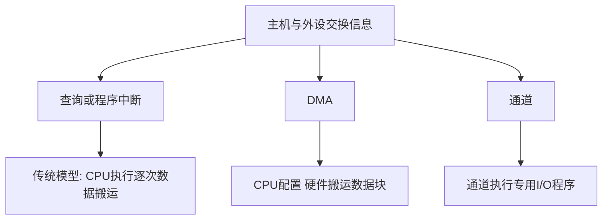

# IO系统组成与控制方式

返回 [[第七章 输入输出系统]]。来源：[[第七章原图与识别说明#原图01|原图01]]、[[第七章原图与识别说明#原图06|原图06]]、[[第七章原图与识别说明#原图08|原图08]]、[[第七章原图与识别说明#原图12|原图12]]。

## I/O的范围
I/O即输入/输出。输入设备把信息送入主机，输出设备向外提供信息，磁盘等存储设备可兼具读写功能。光盘是否可写取决于介质和设备，不能把所有光盘都归为可写设备。

I/O系统包含外部设备、接口/控制器、互连等硬件，以及驱动程序和相关软件。用户程序经软件层请求I/O，不等于直接读写硬件；本章以硬件控制方式为主。

## 四种控制思路
- 程序查询：CPU通过程序读状态，在就绪后由CPU执行数据搬运。忙等待会占用CPU；定时查询可以在间隔做其他事。
- 程序中断：目标就绪时发中断，CPU进入服务程序完成本次需要的软件处理；传统程序中断传送中，数据仍由CPU搬运。
- DMA：CPU配置起始位置、方向和计数等，硬件完成成批搬运，不需要CPU逐字执行传送指令；完成可用中断等方式通知。
- 通道：通道执行专用通道程序，组织更复杂的I/O任务，CPU发起后可继续工作。

## 补充图：谁搬数据、谁管理任务

不能只凭“有中断”判断属于程序中断传送：DMA也可以用完成中断。应看**数据由谁搬、CPU参与到哪一步**。

照片把程序查询称为CPU与I/O串行，是指忙等待时CPU不能有效执行其他任务，不是说外设准备期间CPU物理上停止运行。

关联：[[IO接口功能与寄存器]]、[[程序查询与定时查询]]、[[DMA控制器与传送过程]]、[[通道控制与通道程序]]。
