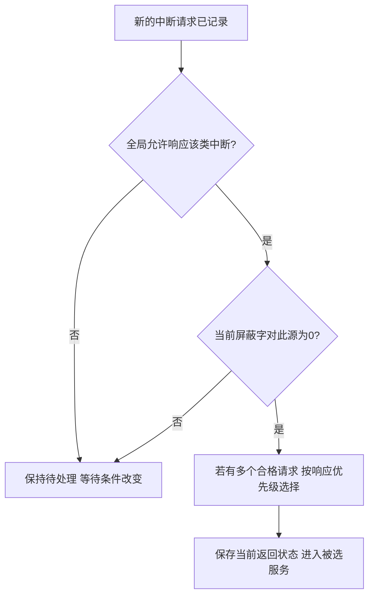

# 中断优先级与屏蔽字

返回 [[第七章 输入输出系统]]。来源：[[第七章原图与识别说明#原图03|原图03]]、[[第七章原图与识别说明#原图10|原图10]]、[[第七章原图与识别说明#原图11|原图11]]。

## 响应优先级与处理优先级
**响应优先级**：多个符合条件的请求同时出现时，硬件或软件判优先选哪个。

**处理优先级**：服务程序运行期间，允许哪些来源打断当前服务。屏蔽字可配合开中断实现特定嵌套关系，通常不改变底层同时请求判优电路的固有次序。

因此不要把“处理优先级D最高”直接改写成“任何时刻硬件必先响应D”；要同时看题给判优顺序、屏蔽、当前服务与到达时刻。

## 屏蔽字的约定
本课照片采用1=屏蔽、0=允许。要先读题确认有效极性；不要与请求标志1=有请求混淆。

在本课每个中断源不允许自身重入、优先级形成严格全序的模型中：当前服务时屏蔽自身及处理优先级不高于自己的来源，允许更高处理优先级抢占；进入时保存旧屏蔽字，退出时恢复。

## 原图03例：A、B、C、D
硬件响应顺序A>B>C>D，希望嵌套处理优先级D>A>C>B。列按A、B、C、D，行表示正在运行哪个服务程序：
```text
当前服务    A B C D    屏蔽字
A           1 1 1 0    1110
B           0 1 0 0    0100
C           0 1 1 0    0110
D           1 1 1 1    1111
```

该矩阵与照片校正后的结果一致。逐行核对：A只允许D；B允许A/C/D；C允许A/D；D不允许其他这些来源抢占。

## 补充判定图：一个新请求能否抢占当前服务


## 不宜当成普遍规律的速记
- “1越多优先级越高”只在上面这种屏蔽自身及所有较低级、严格全序的构造中可作检查；一般屏蔽策略、相同级或任意掩码不能靠数1排序。
- 高速、实时、输入设备常因服务期限而被安排较高优先级，但不是不依题设的固定法则。
- 故障、NMI、软件中断/异常属于不同机制，不能只画一条“所有故障永远高于所有软件”的通用排序。
- DMA请求是总线/访存仲裁事件，普通I/O中断是CPU转入处理程序的事件；“DMA优先”是本课某些模型的规则，不是所有平台统一中断优先级。

关联：[[中断请求响应与隐指令]]、[[多重中断与现场保护]]、[[DMA传送方式与访存仲裁]]。
