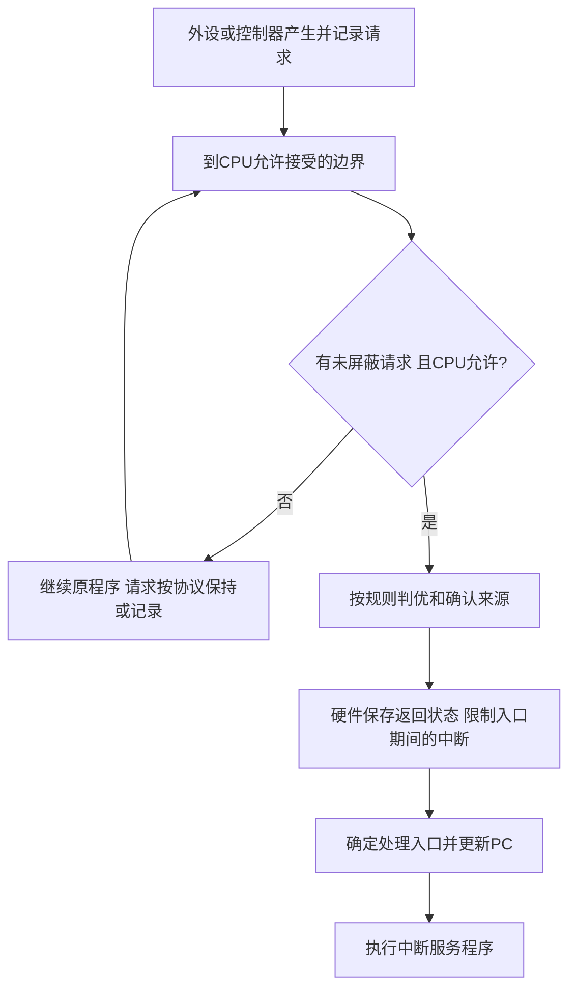

# 中断请求响应与隐指令

返回 [[第七章 输入输出系统]]。来源：[[第七章原图与识别说明#原图02|原图02]]、[[第七章原图与识别说明#原图07|原图07]]、[[第七章原图与识别说明#原图10|原图10]]、[[第七章原图与识别说明#原图11|原图11]]。

## 请求不等于立即响应
中断源在事件发生时提出请求，可由请求标志锁存等待处理；标志为1是本笔记采用的有效约定。标志可能位于接口、中断控制器或CPU内，具体实现不同。

传统教材中，可屏蔽外部中断的响应通常要求：存在未屏蔽请求、CPU允许中断、到达可接受的指令边界且没有阻止响应的更高优先级条件。多请求同时有效时还需判优。

“在每条指令执行阶段末尾检查”是简化模型。现代处理器在体系结构规定的边界接受外部中断，不要求软件可观察到一次真实逐条接口轮询；同步异常也不能直接套用这个规则。

## IF与中断屏蔽
x86中IF控制普通可屏蔽外部中断的使能：IF=1允许，IF=0禁止；还需满足其他条件。IF=0不屏蔽NMI，也不阻止处理器自身的同步异常。照片“关中断保证原子”只适合受这些可屏蔽中断影响的本地临界区，不能据此保证多核下全部操作原子。

## 中断隐指令
不是程序员编写的一条机器指令，而是响应时由硬件完成的隐含操作序列。在本课典型模型中：
1. 保护断点，保存返回PC及必要状态。
2. 临时关闭或限制相关中断，防止入口阶段现场遭破坏。
3. 获得服务入口并更新PC，转入处理程序。

顺序和保存内容依架构，不能把以上列表当所有CPU的固定微操作顺序；有的x86入口通过中断门清IF、陷阱门不清IF。

## 补充流程图：外部中断响应

这里的硬件响应与软件服务阶段要区分，不能把全部通用寄存器的保护都算成隐指令必做。

核对：[Intel系统编程手册：Interrupt and Exception Handling](https://www.intel.com/content/dam/www/public/us/en/documents/manuals/64-ia-32-architectures-software-developer-system-programming-manual-325384.pdf)。

关联：[[取指间址与中断响应]]、[[中断向量与服务程序]]、[[中断优先级与屏蔽字]]、[[多重中断与现场保护]]。
