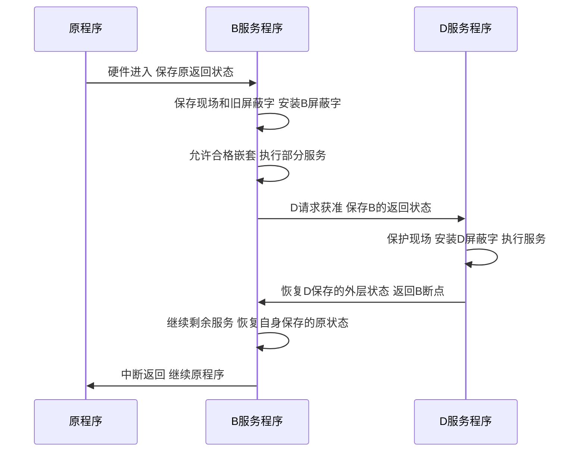

# 多重中断与现场保护

返回 [[第七章 输入输出系统]]。来源：[[第七章原图与识别说明#原图03|原图03]]、[[第七章原图与识别说明#原图07|原图07]]、[[第七章原图与识别说明#原图10|原图10]]。

## 单重与多重
单重中断模型：进入服务后持续禁止相应可屏蔽中断，完成后再恢复。

多重中断/嵌套：当前服务程序可以被符合允许条件的更高处理优先级来源打断，完成内层服务后返回外层，再最终返回原程序。

开中断只是必要条件之一，还须配置合适的屏蔽/优先级、保存现场，并保证栈空间和处理程序允许这种嵌套。

## 典型受保护步骤
在本课模型中：硬件进入并限制中断→保存软件现场和旧屏蔽字→装入当前服务的屏蔽字→允许合格的嵌套→执行服务→限制恢复阶段的中断→恢复屏蔽和现场→依架构恢复原中断状态并返回。

“限制”针对相应可屏蔽中断；不能据此保证NMI、所有故障都不发生。返回可能通过专用返回指令一起恢复状态，不必存在独立的“开中断后再返回”指令序列。屏蔽字装载之前不要为方便随意提前开中断。

## 补充时序图：B服务被D抢占后恢复

## 补充算例：按时间推进，不能重启整段服务
沿用 [[中断优先级与屏蔽字]] 的处理顺序D>A>C>B与掩码。**以下到达时间是新增示例，不是原图03缺失题干的还原。**

设B在0 ns开始执行，A在5 ns、D在8 ns、C在10 ns提出请求，各需纯服务20 ns，忽略全部响应/保存/恢复开销；中断只在本例抽象事件边界生效。

C在10 ns到达时不能抢占D，D结束恢复A后，C仍不能抢占A；A完成恢复B时，待处理的C才可抢占B。总纯服务时间4×20=80 ns，没有因抢占而丢弃已完成工作。

原图03底部曲线提供了示意，但题干、到达标记及相关开销不完整，不据图单独断言全部准确完成时刻。补齐题干后可另行核对原例。

关联：[[中断向量与服务程序]]、[[中断优先级与屏蔽字]]、[[IO查询开销与中断开销计算]]。
