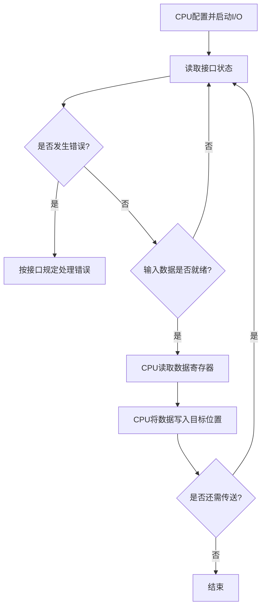
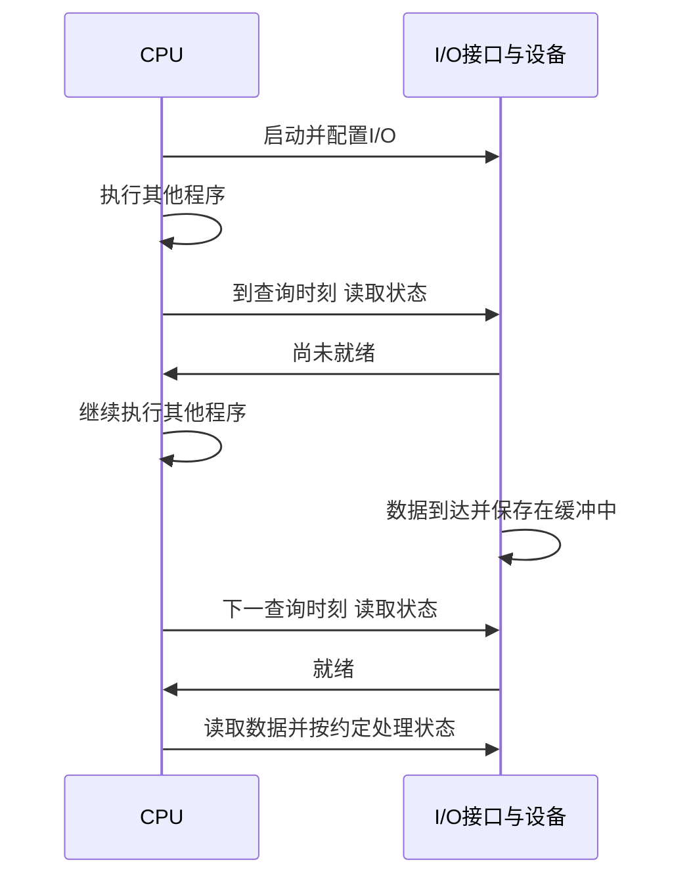

# 程序查询与定时查询

返回 [[第七章 输入输出系统]]。来源：[[第七章原图与识别说明#原图01|原图01]]、[[第七章原图与识别说明#原图02|原图02]]、[[第七章原图与识别说明#原图06|原图06]]、[[第七章原图与识别说明#原图13|原图13]]。

## 忙等待查询
CPU启动I/O后，反复读取状态，未就绪就继续查询；就绪后CPU执行数据读写。简单、硬件开销较小，但CPU时间可能大量花在空等上。

## 补充流程图：输入一个数据单位

对输出应检查可写/空闲条件，再写数据。实际设备状态的读清除等副作用依手册；图示不要求所有设备都同时具备独立错误位和就绪位。

## 定时查询
在保证缓冲不溢出、不漏服务的条件下，每隔一段时间检查一次；两次检查之间CPU可以执行其他工作。

## 补充时序图：把查询分散到时间间隔

若缓冲有b字节且持续输入速率为R B/s，b/R可作为理想填满时间的估计；真实查询间隔还需留出搬运和调度裕量，并考虑突发。不能只要“定时”就保证不丢数据。

原图01以`scanf`类比输入，并不能据此断定C库函数在CPU上忙轮询；实际行为取决于运行环境和驱动。

关联：[[IO查询开销与中断开销计算]]、[[IO系统组成与控制方式]]、[[中断请求响应与隐指令]]。
