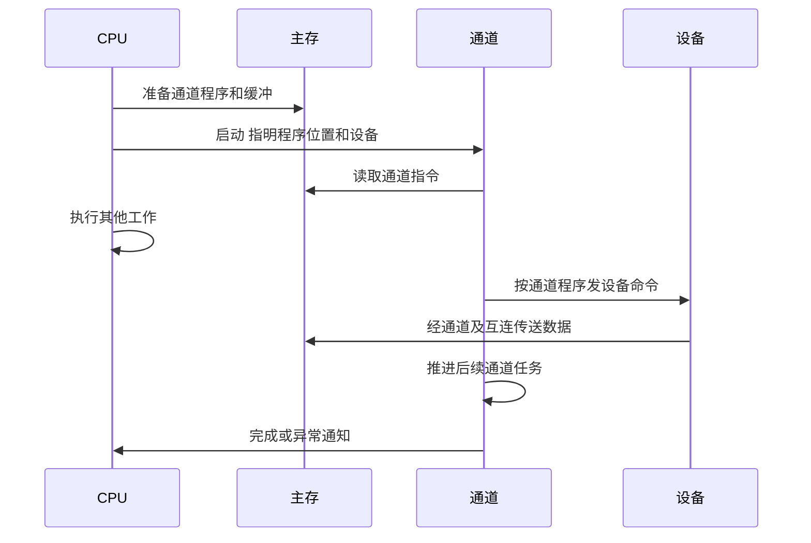

# 通道控制与通道程序

返回 [[第七章 输入输出系统]]。来源：[[第七章原图与识别说明#原图08|原图08]]、[[第七章原图与识别说明#原图12|原图12]]。

## 通道是什么
本课把通道描述为具有有限专用指令集的I/O控制部件，可执行通道程序，负责一系列设备管理和数据传送。称为“弱化版CPU”只是类比，不代表它能执行普通CPU程序或具备完全相同的功能。

## 两类指令不要混淆
CPU的I/O指令：由CPU执行，用于发起/管理I/O等。照片的“操作码—命令码—设备码”是教材抽象格式，不是所有架构统一的机器码字段。

通道指令：由通道识别并执行。通道程序通常预先存于主存，包含一系列设备操作；CPU给出程序位置和设备等信息后启动通道。

## 工作过程
1. CPU/软件准备通道程序和数据缓冲，发启动命令。
2. 通道从主存取通道指令，控制相应设备完成规定任务。
3. CPU可继续其他工作；完成/异常由通道按系统规则报告，常采用I/O中断。

## 补充时序图：通道独立执行I/O程序

“设备到主存”箭头是由通道/互连组织的数据路径缩写，不表示设备可脱离控制直接驱动任意内存；实际通道结构和传送方向依具体系统。

## 与DMA的关系
典型DMA擅长按配置搬运数据块；通道可执行专门程序、组织较复杂任务，进一步减轻CPU管理负担。两者是教材功能层面的区分，现代控制器可能结合这些能力，不必硬套为互斥标签。

参考：[IBM通道子系统简介](https://www.ibm.com/docs/en/zos-basic-skills?topic=mainframe-channel-subsystem-css)作为实际系统的对照，具体IBM指令与机制不额外列为本课新考点。

关联：[[IO系统组成与控制方式]]、[[DMA控制器与传送过程]]、[[系统总线结构与桥接]]、[[IO端口编址与IN OUT指令]]。
