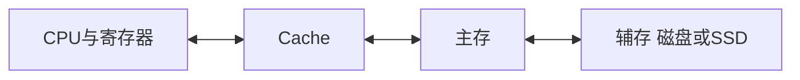

# 存储层次与存储器分类

返回 [[第三章 存储系统]]。来源：[[第三章原图与识别说明#原图01|原图01]]、[[第三章原图与识别说明#原图02|原图02]]。

## 存储层次
寄存器 → Cache → 主存 → 辅存，通常越靠近CPU，访问延迟越低、容量越小、单位容量成本越高。这是层次结构的一般趋势，不是对所有器件逐个比较的定律。

Cache—主存层主要缓和CPU与主存的速度差异，通常由硬件管理；主存—辅存配合提供容量较大的存储环境。原图提到虚拟存储，仅保留这一概念联系，不展开为本课学习任务。

## 不同分类维度
- 按介质：半导体、磁表面、光存储等。SSD虽属外存，也采用半导体，不能把半导体存储器只理解为主存和Cache。
- 按访问方式：RAM随机存取；SAM顺序存取；DAM直接存取，先定位区域再访问目标。磁带常作SAM例子，磁盘常作DAM例子。
- 按可改写性：读写存储器、只读存储器；ROM家族包含可编程、可擦写类型，不能把家族中每一种都说成永远不能写。
- 按掉电保持性：易失性与非易失性；按读出是否影响单元状态：破坏性与非破坏性。这两个维度独立。

SRAM通常非破坏性读出，DRAM读出需恢复。读出破坏性不等于掉电易失性；两者都需要供电才能保持数据。

随机存取在教材模型中表示访问时间基本不随地址位置改变，不是保证现实CPU每次访问延迟完全相同。

关联：[[SRAM与DRAM]]、[[ROM与Flash存储器]]、[[Cache局部性与平均访问时间]]。
