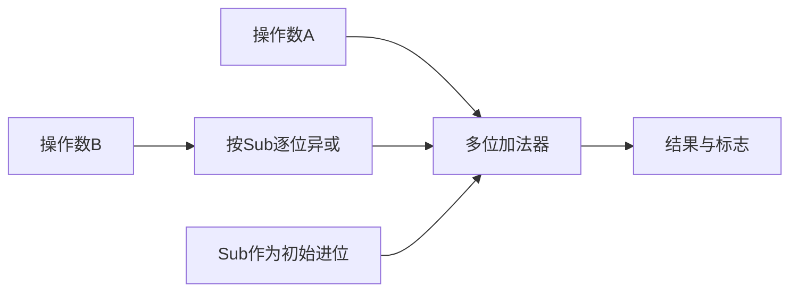

# 加法器与ALU

返回 [[第二章 数据的表示和运算]]。来源：[[第二章原图与识别说明#原图07|原图07]]、[[第二章原图与识别说明#原图12|原图12]]、[[第二章原图与识别说明#原图17|原图17]]、[[第二章原图与识别说明#原图15|原图15]]。

## 全加器
一位全加器有输入 $A_i,B_i,C_{i-1}$，输出本位和与进位：
$$S_i=A_i\oplus B_i\oplus C_{i-1}$$
$$C_i=A_iB_i+(A_i\oplus B_i)C_{i-1}$$

进位在三个输入至少两个为1时产生。

## 多位加法
串行进位的并行加法器：两个操作数各位并行输入，但进位依次传播；位数增加会使最长进位延迟增加。“并行输入”不等于“并行进位”。

先行进位CLA：设 $G_i=A_iB_i$，$P_i=A_i\oplus B_i$，则 $C_i=G_i+P_iC_{i-1}$。展开后可减少逐位等待，但仍有门延迟，不能写成“所有进位没有延迟地同时产生”。

## 加减共用电路
控制Sub=0加法，Sub=1减法：
$$S=A+(B\oplus\{w\{Sub\}\})+Sub\pmod {2^w}$$
即减法时B各位取反，并向最低位送进位1。相同电路可以计算有符号或无符号位串，结果的解释与标志判断不同。

## ALU
ALU是组合逻辑部件，按控制信号选择算术或逻辑结果；常含加法器、逻辑电路与选择器。具体是否集成乘除、移位等功能由实现决定。

支持k种操作的编码控制信号至少需要 $\lceil\log_2k\rceil$ 位。教材通常把ALU宽度与机器字长联系起来，但真实机器也可能有不同位宽的执行单元。

标志可写入PSW或专用标志寄存器，具体见 [[定点加减与溢出标志]]。关联第一章 [[运算器与控制器]]。
