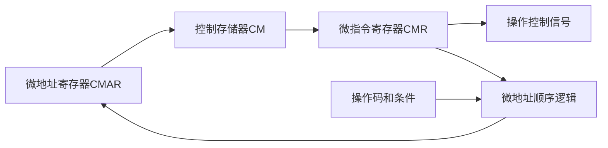

# 微程序控制器与控制存储器

返回 [[第五章 CPU]]。来源：[[第五章原图与识别说明#原图01|原图01]]、[[第五章原图与识别说明#原图02|原图02]]、[[第五章原图与识别说明#原图17|原图17]]、[[第五章原图与识别说明#原图27|原图27]]。

## 概念层次
机器程序由机器指令组成；微程序由微指令组成，组织实现机器指令等控制过程；微指令可发出一个或多个微命令来控制微操作。

一条机器指令对应一段执行控制流程是教学抽象，可以与其他指令共享取指、地址计算等微程序段。因此“n条机器指令至少n+1个物理独立微程序”不能作为普遍计数定律。照片的n+1只是在统一取指段加n个执行段、且不另计共享/中断等流程的模型下成立。

## 控制存储器
控制存储器CS/CM保存微指令，不是保存普通用户数据的主存。常见教学结构包括：
- CMAR/μPC：下一待取微指令的地址。
- CMR/μIR：暂存已读出的微指令。
- 微地址形成与顺序逻辑：根据操作码、微指令后继信息和条件确定下一地址。

一条微指令的周期包括读出微指令并完成相应控制/转移所需时间，具体分相与节拍依实现。

## 静态、动态与毫微程序
静态微程序使用固定或通常不改变的控制内容；动态微程序允许在受控条件下更新可写控制存储器。不能把EPROM当作唯一动态实现，也不能说修改微码可无条件实现任意新ISA。

毫微程序是进一步分层解释控制信息的设计：微指令再经更低层控制序列实现。此处按照片概念保留，不展开具体电路。

微程序控制和硬布线可以组合，现代处理器的所有指令不一定全由同一种路径解释。

关联：[[硬布线控制器与微操作时序]]、[[微指令格式与字段编码]]、[[软件语言与系统层次]]。
