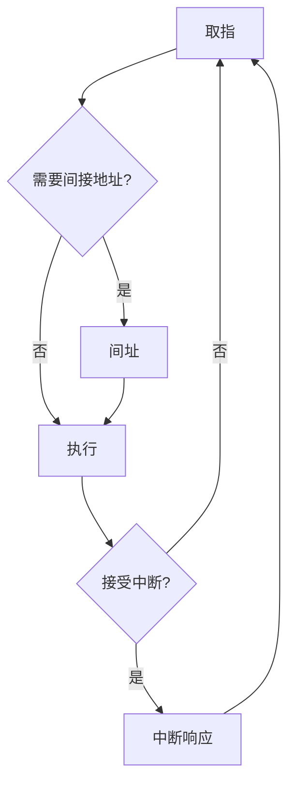

# 指令周期与执行方案

返回 [[第五章 CPU]]。来源：[[第五章原图与识别说明#原图09|原图09]]、[[第五章原图与识别说明#原图12|原图12]]、[[第五章原图与识别说明#原图15|原图15]]、[[第五章原图与识别说明#原图16|原图16]]。

## 三种周期
时钟周期：基本同步时间间隔。机器周期：教材为组织一种较完整操作划分的时间段，可含若干节拍。指令周期：完成一条指令所需的全过程。

一个指令周期可含若干机器周期；不同指令的机器周期数和每周期节拍数可以不同。“机器周期”不是所有现代CPU都以同样方式暴露的固定术语。

## 四个阶段模型
1. 取指FE：PC提供地址，读取指令至IR，更新顺序PC。
2. 间址IND（如需要）：读取指针以形成有效地址，不是直接取得最终操作数。
3. 执行EX：完成指令规定的访存、运算、写回或转移等。
4. 中断INT（若被接受）：保存返回状态并转入处理入口。

FE/IND/EX/INT是教材周期状态，不能和五段流水的IF/ID/EX/MEM/WB逐一等同。

NOP可没有独立的执行机器周期，不代表不取指、不译码或时间为0。流水线中的NOP也可能按流水节拍占用位置。

## 实现方案
单周期：一条指令一个较长时钟周期，周期受最长指令路径约束。
多周期：一条指令拆成多个较短周期，不同指令用不同周期数，通常可复用功能部件。
流水线：多条指令处于不同阶段，理想情况下每周期启动/完成一条，但单条仍经过若干阶段，且有填充、冲突和清空开销。

关联：[[指令执行过程]]、[[流水线重叠执行与性能计算]]。
