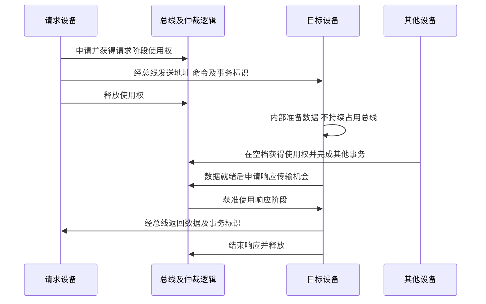

# 分离式传输与总线利用率

返回 [[第六章 总线]]。来源：[[第六章原图与识别说明#原图08|原图08]]。

## 为什么分离
传统简单读事务中：主设备发地址/命令，目标内部准备，目标返回数据。若等待期间总线仍被整笔占用，其他设备无法利用空档。

分离式传输把请求与响应分成不同的总线占用阶段：请求发出后释放总线，准备完成后响应方或协议规定的响应通路再获得传输机会。

## 补充时序图：等待期间让出总线
这是共享总线教材模型，不是特定AXI/PCIe协议的逐信号复刻。

## 收益与代价
可把目标设备的内部准备时间与其他事务重叠，提高总线利用率；不会消除目标自身的访问延迟，也不保证每个请求更早完成。

需要保存未完成请求状态，通常要有事务标识、缓冲、匹配及顺序控制。目标是否作为新主设备申请、响应是否经独立通道，由实际协议决定。

照片“不同步等待对方回答”应理解为不必长期占有总线等待，**不是整个请求无需任何应答或错误检查**。“采用同步方式”是原图这一实现模型的特征，不是事务拆分本身必然要求的物理定时方式。

分离式和地址/数据引脚复用不同：前者拆开事务阶段的占用，后者让同一组线分时表达不同信号。

参考：[AMD AXI事务显示说明](https://docs.amd.com/r/2024.1-English/ug908-vivado-programming-debugging/AXI-Transactions-in-the-Waveform-Viewer?contentId=tKmcmLAT2NF~IOWtgzZXBQ)展示地址、数据/响应按通道及ID关联，可作现代协议对照，不作为本课新考点。

关联：[[总线周期频率与带宽]]、[[总线复用与串并行比较]]、[[总线传输过程与使用权]]。
