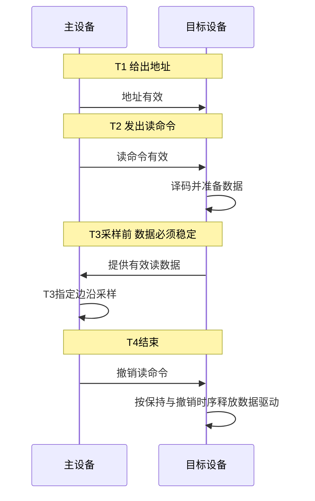
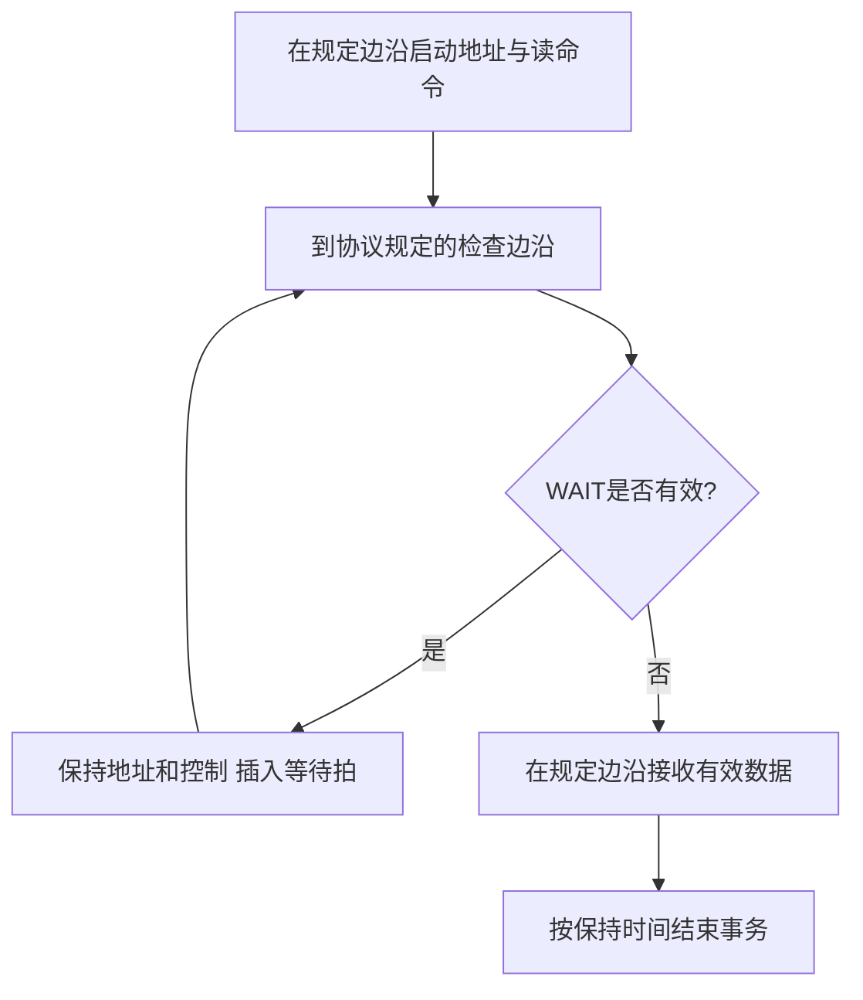

# 同步定时与半同步通信

返回 [[第六章 总线]]。来源：[[第六章原图与识别说明#原图02|原图02]]、[[第六章原图与识别说明#原图06|原图06]]、[[第六章原图与识别说明#原图08|原图08]]。

## 同步定时
用公共或协议约定的时钟边沿规定发送、采样与状态推进。传统固定拍数模型通常控制简单，要求设备满足既定时序，适合时延较可预测的连接。

同步不等于所有设备内部完全同速，也不等于不能有就绪/有效反馈。纯固定周期且无等待机制时，慢设备不能临时要求延长既定周期，需要设计时保证时序。

## 补充时序图：照片T1—T4同步读的概念版
假定命令在T2有效，数据必须在T3采样边沿之前满足建立时间。这里只说明事件先后，未给精确电平波形与纳秒约束。

“可靠性较差”不是同步总线固有结论；只是在无反馈的固定时序模型中，若目标超时则不能自动保证成功。有效性检测、错误响应和重试可另行设计。

## 半同步
保留统一时钟，但加入WAIT/READY等允许延长访问的状态。等待信号是否低有效、在哪个边沿检查及解除后何时采样，由协议定义。

## 补充流程图：按拍等待的读访问
此图以WAIT=有效表示继续等待，不绑定具体0/1电平。

现代同步接口常有更细的有效/就绪握手，并不一定严格对应教材半同步信号形式。参考：[Avalon官方接口规范](https://cdrdv2-public.intel.com/667068/mnl_avalon_spec-683091-667068.pdf)，等待与读数据有效信号可分别约束命令和返回。

关联：[[总线周期频率与带宽]]、[[异步握手与互锁]]。
