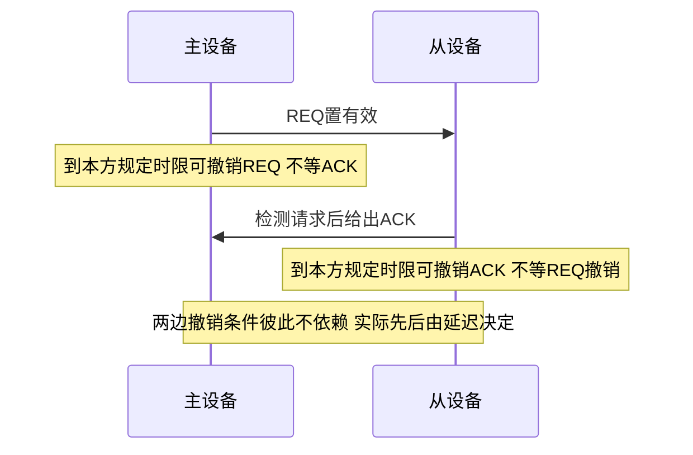
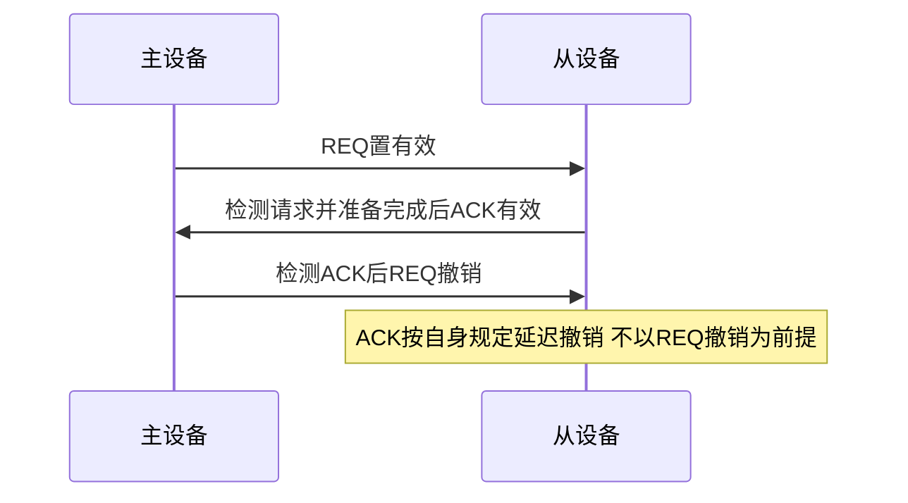
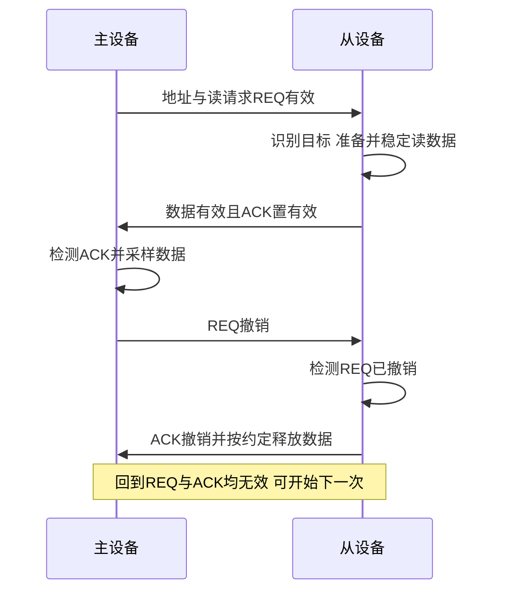

# 异步握手与互锁

返回 [[第六章 总线]]。来源：[[第六章原图与识别说明#原图06|原图06]]。

## 异步定时
总线交易推进不依靠统一固定拍数，而依据请求、应答等事件协商。端点内部仍可能有时钟，不代表整台设备完全没有时钟；跨时钟/异步输入还需满足实现的同步与电气约束。

本页按照片的请求REQ、应答ACK教材模型，概念性约定有效=1、无效=0，不绑定实际低有效引脚。

## 不互锁
主设备发请求后，按预定延迟撤销，不等待应答；从设备发出应答后也按自身延迟撤销，不等待对方请求撤销。必须有满足传播、识别和采样的时间假设，不能靠“双方都等固定时间”保证任意延迟下可靠。

## 补充时序图1：不互锁的撤销条件

## 半互锁
主设备须收到ACK才撤销REQ；从设备发出ACK后不等REQ撤销，可在规定延迟后撤销ACK。只建立单方向的撤销依赖。

## 补充时序图2：半互锁

这里图上列出的REQ撤销先后只是示意，ACK的实际撤销不受REQ约束，可能先于REQ被从设备观察为撤销。

## 全互锁：四相握手
双方撤销均以前一步被观察到为条件。对读传输，ACK有效前从设备须已保证读数据有效；主设备采样后才能释放相应请求。

## 补充时序图3：完整四相读握手

全互锁提供更完整的交互确认，往返等待开销也更多；照片“速度最慢、最可靠”是简化比较，只有在相同器件、延迟和实现条件下才有意义，协议正确也不能消除硬件故障或超时问题。

关联：[[总线传输过程与使用权]]、[[同步定时与半同步通信]]、[[分离式传输与总线利用率]]。
