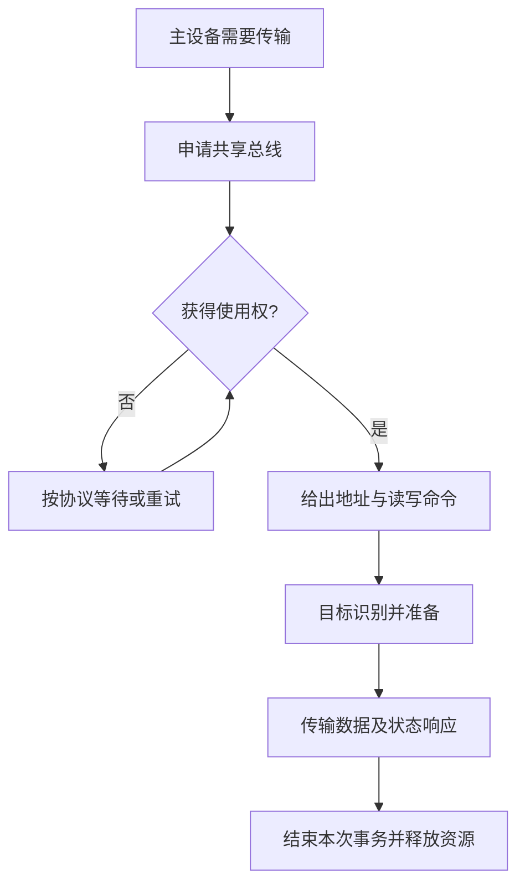

# 总线传输过程与使用权

返回 [[第六章 总线]]。来源：[[第六章原图与识别说明#原图01|原图01]]、[[第六章原图与识别说明#原图02|原图02]]。

## 主设备与从设备
主设备/主模块发起本次事务，从设备/目标响应。读事务中从设备可向主设备送数据，但仍不因此成为该读事务的发起主设备。

多主设备共享同一资源时，需要仲裁或协议化选择，避免冲突。照片只概述申请/分配，本节补充使用权流程，不额外展开链式查询等具体仲裁算法。

## 四阶段模型
1. 申请/分配：有需求的主设备申请，总线管理逻辑选出本次获得者。
2. 寻址：主设备提供地址、命令等，选中目标。
3. 传输：按读写方向交换数据，处理就绪/响应和等待。
4. 结束：撤销本次相关信号、释放共享资源，允许后续使用。

四阶段是逻辑划分，不保证严格四拍，也可能在协议允许时重叠或省略某些独立阶段。

## 补充流程图：一次共享总线事务

## 广播与独占
共享通路允许多个部件观察信号，不代表所有部件都必须响应。地址译码、片选及协议决定真正接收者。普通共享数据总线通常避免多个发送端同时驱动；线与仲裁等专门协议按其电气规则处理。

## 完成与错误
教材图通常画成功完成；实际协议还可能有超时、重试、错误终止。不要把“没有响应一直等”当作系统层面可接受的无限等待保证。

关联：[[主存与CPU连接及容量扩展]]、[[同步定时与半同步通信]]、[[异步握手与互锁]]。
