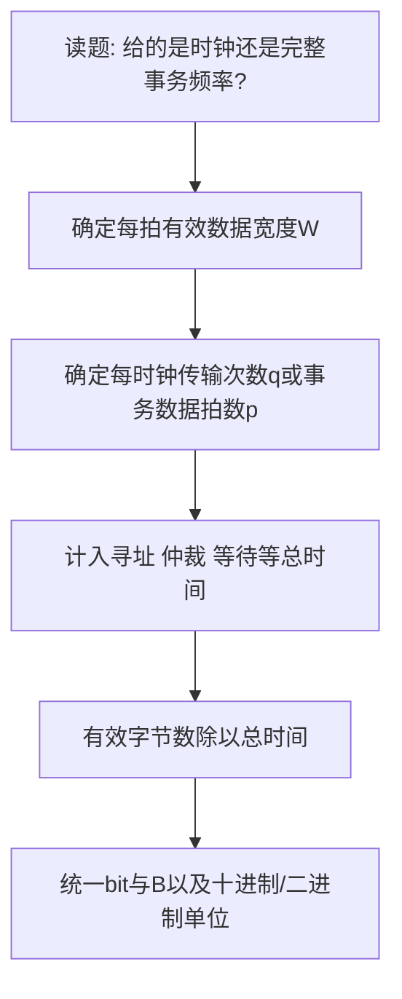

# 总线周期频率与带宽

返回 [[第六章 总线]]。来源：[[第六章原图与识别说明#原图01|原图01]]、[[第六章原图与识别说明#原图03|原图03]]。

## 先定义时间与数据量
总线时钟周期Tclk是时钟重复间隔，fclk=1/Tclk。总线事务/传输周期是完成一次规定操作的全过程，可能含仲裁、地址、数据和结束，往往不止一个时钟。

照片“总线工作频率=总线周期倒数”是在用工作频率表示**每秒完整传输次数**；有些资料又把工作频率当作时钟频率。计算前先明确名称对应哪一种。

总线周期与时钟周期关系依协议、流水、突发及等待而定，不能只凭“通常几拍”判断吞吐率。

数据总线宽度（位宽）指数据通路同时并行传送的位数，例如32位；不要与地址线数、控制线数或全部连接器引脚数混淆。

## 峰值公式
若数据通路W位、时钟fclk、每时钟可传q次完整W位数据，理想数据相位峰值：
$$B_{peak}=Wf_{clk}q\ \mathrm{bit/s}=\frac{Wf_{clk}q}{8}\ \mathrm{B/s}$$

若一次完整事务用N拍、共传p个W位数据拍，忽略重叠：
$$B_{transaction}=\frac{pW}{N T_{clk}}\ \mathrm{bit/s}$$

只有每周期传一个数据且没有额外开销时，才可简化为“位宽×时钟频率”。DDR等q不为1；突发时p也不必为1。

## 有效带宽
$$B_{effective}=\frac{实际有效数据字节数}{实际总耗时}$$
总耗时可包含仲裁、寻址、等待、方向切换、校验/编码与协议开销；具体计哪些须依题设。不能把信号线数当数据位宽，也不能把MHz直接当MB/s。

## 补充图：带宽解题顺序

## 补充算例
32位、100 MHz、SDR每拍一个字，数据相位峰值400 MB/s；同宽同频DDR理论为800 MB/s。这里MB=10^6 B。

若32位100 MHz总线每个完整事务4拍且仅传1个字，则有效速率为4 B/40 ns=100 MB/s，不是400 MB/s。

若同一总线一次突发用2拍寻址/准备、4拍传4字，无其他开销：有效16 B/60 ns≈266.67 MB/s。

关联：[[存储容量编址与性能指标]]、[[计算机性能指标]]、[[同步定时与半同步通信]]。
