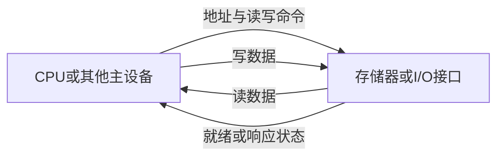

# 总线基础分类与信号

返回 [[第六章 总线]]。来源：[[第六章原图与识别说明#原图05|原图05]]、[[第六章原图与识别说明#原图07|原图07]]。

## 总线是什么
总线是一组按协议传送信息的公共连接。在传统共享总线模型中，多部件分时使用同一传输资源，某个数据方向上通常只能由选定发送端驱动，允许一个或多个部件接收。

“同一时刻只有一个部件发送”须限定在**同一共享通路和方向**；地址、数据、状态可由不同参与方按协议提供，独立通道或分段连接还可能并行工作。

## 四类特性
- 机械：连接器形状、引脚和排列等。
- 电气：电平、驱动和负载约束等，信号方向也需结合接口定义。
- 功能：各信号承担地址、数据、控制等角色。
- 时间：信号先后、保持、采样和响应关系。

## 按连接范围
片内总线连接芯片内部部件；系统总线/互连连接CPU、主存控制器、I/O接口等；通信总线或外部接口连接系统与外部设备/系统。命名取决于教材与体系结构，不能把所有现代互连都当作一条物理共享线。

## 地址、数据、控制
传统系统总线中的DB传指令/操作数，AB标识目标地址，CB传读写、请求、就绪等控制或状态。

地址由**本次事务的主设备/发起者**给出；CPU访问时通常CPU发地址，但DMA等主设备也可发地址。数据方向取决于读写，控制线也可能来自不同方向。

## 位数与编址范围
数据总线宽度决定一拍能并行传多少位，常与机器字长、存储字长有关，但三者不必相等；宽数据也可通过多拍窄总线传送。

若有k条独立地址线，并且全部地址编码可用，则可区分2^k个地址单元；容量还要乘每个地址单元的字节数。按字节编址时32位地址覆盖4 GiB地址空间，这不等于机器实际安装4 GiB内存，也可能包含I/O映射或保留区域。

## 补充图：CPU发起读写时的信号角色
以下是功能关系图，不代表每种接口都有三套独立引脚。

“数据通路”是数据经过的路径，数据总线是其中一种实现，不能把二者完全等同。

关联：[[数据通路与单总线微操作]]、[[主存与CPU连接及容量扩展]]、[[总线复用与串并行比较]]。
