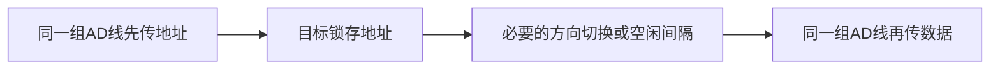

# 总线复用与串并行比较

返回 [[第六章 总线]]。来源：[[第六章原图与识别说明#原图01|原图01]]、[[第六章原图与识别说明#原图05|原图05]]、[[第六章原图与识别说明#原图07|原图07]]。

## 串行与并行
串行在一个数据通道上按时间依次传位，并行通过多条数据位通路同时传位。实际串行链路可能使用差分线对、独立方向及多条lane，不能从“串行”推出只有一根物理导线。

相同通道数量、相同每通道位速率及相同开销下，并行可同时送更多位；但不同标准的速率、通道和编码开销不同，不能笼统断言串行必慢。

并行线多，走线、串扰、时钟偏斜和连接成本可能限制距离与频率。高速串行可通过提高每通道速率及增加通道提高吞吐，但也不是可无限提高频率。

## 总线复用
同一组物理信号线在不同时间传不同类别信息，例如先传地址，再传数据。减少引脚和布线，代价是需要分时控制、锁存及可能的额外阶段。

## 补充图：地址/数据复用的概念时间线
不是某个具体芯片的波形；箭头表示不同阶段，地址需先被目标锁存。

## 信号线数与引脚数
不复用的教材模型中，地址线、数据线、控制线相加可得到对应的信号线总数。若复用，不能重复计数同一组物理线；若问实际连接器引脚，还可能含电源、地、时钟、屏蔽或差分配对等。

补充例：32条地址线+32条数据线+8条已列明控制线=72条信号线；该数不自动等于设备所有引脚数。

关联：[[总线基础分类与信号]]、[[总线周期频率与带宽]]。
