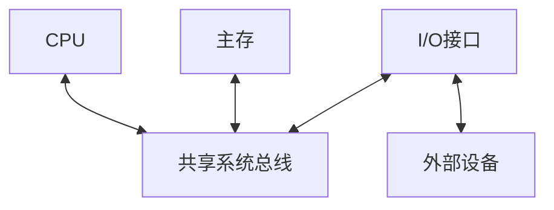
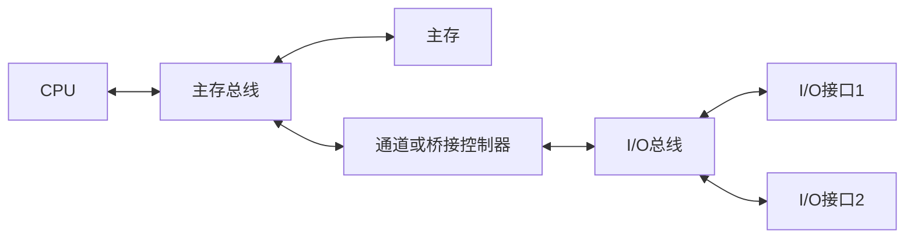
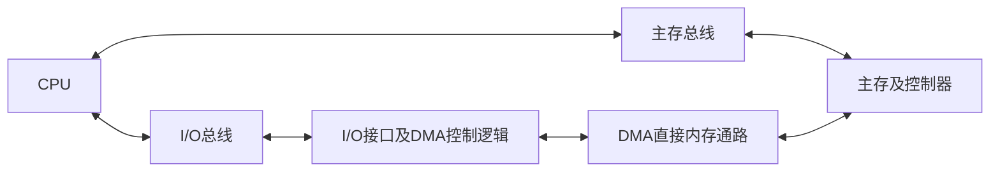

# 系统总线结构与桥接

返回 [[第六章 总线]]。来源：[[第六章原图与识别说明#原图03|原图03]]、[[第六章原图与识别说明#原图04|原图04]]。

## 单总线
CPU、主存与I/O接口共享一条系统总线。结构简单、成本较低、扩展方便，但共享资源会竞争；某次合法传输还受各端角色和协议限制，不是接到线上就可任意互传。

## 补充结构图1：传统单总线
总线方框表示共享通路；I/O设备通常通过接口连接。

## 双总线
按照片模型，分出主存总线和I/O总线，通道或控制器负责连接、组织I/O，减少慢速设备直接占用主存通路。不同教材对“双总线”的连接画法可能不同。

## 补充结构图2：主存与I/O通路分离

## 三总线
照片给出的模型含主存总线、I/O总线和用于直接内存访问的DMA通路。三者是系统组织划分，不是“地址线+数据线+控制线”三类信号的同义词。

## 补充结构图3：DMA独立通路概念图
图示用于理解通路分工，内存访问仍需仲裁和控制，不代表主存有无限端口。

## 桥接与通道
桥接器连接不同总线/互连，可能做协议、宽度、频率转换和缓冲，也可能有仲裁/地址转换，但不是每个桥都具备完全相同功能。

通道是具有I/O控制能力的部件，可按通道程序管理设备；不能把通道与只做简单转接的桥完全等同。

常见层次中越靠近CPU的通路性能要求越高，但实际速率仍依具体接口；同一段总线的参与设备应遵守该段标准的电气和协议规则，不同段可经桥转换。

多条独立总线可以在不竞争同一瓶颈时重叠工作，并不保证CPU、主存和所有I/O的全部操作都能同时进行。

关联：[[总线传输过程与使用权]]、[[多体交叉存储器]]。
