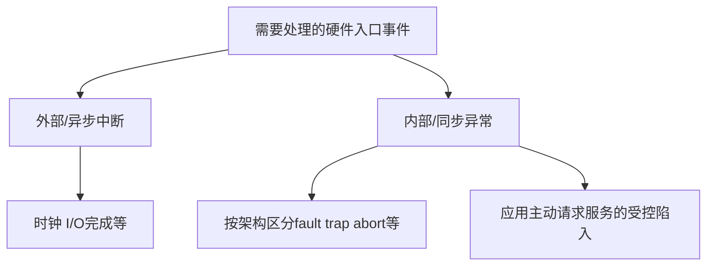
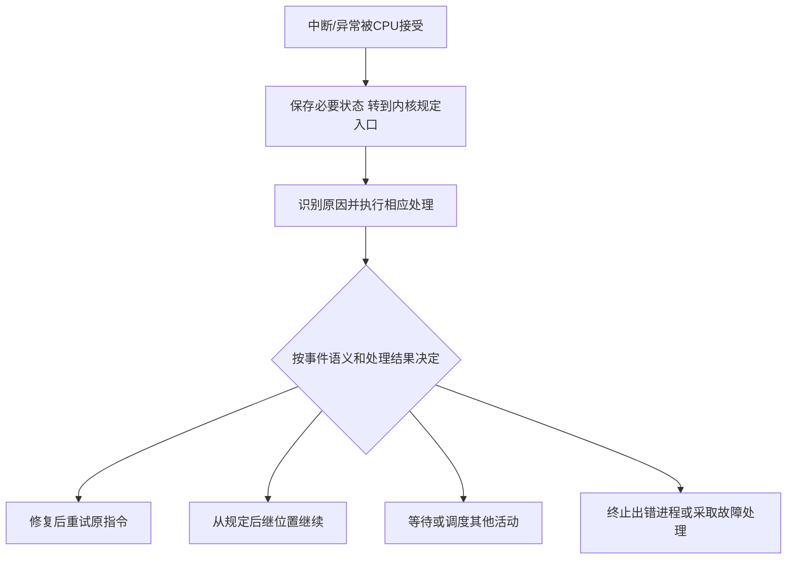

# 中断异常与陷入机制

返回 [[第一章 操作系统概述]]。来源：[[操作系统第一章原图与识别说明#原图01|原图01]]、[[操作系统第一章原图与识别说明#原图07|原图07]]。

## 内外事件的区分
本章广义中断机制包括外部中断和与指令执行相关的异常。外部中断如时钟、I/O完成，通常异步于当前指令；内部异常与当前指令执行的特定条件相关。片上定时器产生的中断仍可属于这类外部/异步事件，不能按芯片物理内外判别。

时钟中断可为操作系统定时与调度提供机会，但中断间隔不一定等于进程时间片，时钟中断也不一定每次都导致进程切换。

## 补充分类图

“陷入”在教材中可泛指主动进入内核；具体架构中trap还可能是严格的异常类别，二者不要机械等同。

## fault、trap、abort与终止进程
按常见x86架构术语：
- Fault（故障）：通常在导致事件的指令处报告，保存状态可支持修正后重试。缺页是常见可修复例；整数除零也是fault类型，并不因应用最终被终止就变成abort。
- Trap（陷阱）：通常在相关指令之后报告，断点是典型例。教材访管/陷入用于说明主动请求服务，不代表现代系统调用一定按这一类异常编码实现。
- Abort（中止，部分教材译终止）：严重错误的一类，通常不能精确定位以便重启原操作，双重故障是x86例子。

原图07把整数除零、用户态非法执行特权指令列作“终止”例子不严谨：这些通常分别产生除法故障、保护类故障；**进程被终止是操作系统的处理结果，不是异常类别的定义**。fault并不保证一定能修复或一定能继续。

## 补充流程图：入口处理后的可能结果

向量表帮助定位入口，但并非所有机器、所有系统调用路径都必须查询同一种中断向量表。外部中断响应通常在可接受指令边界，内部同步异常不能全部套用“等当前指令完整结束”。

核对：[Intel系统编程手册，Interrupt and Exception Handling](https://www.intel.com/content/dam/www/public/us/en/documents/manuals/64-ia-32-architectures-software-developer-system-programming-manual-325384.pdf)。

关联：[[用户态内核态与特权指令]]、[[系统调用与库函数]]、[[中断向量与服务程序]]、[[取指间址与中断响应]]。
