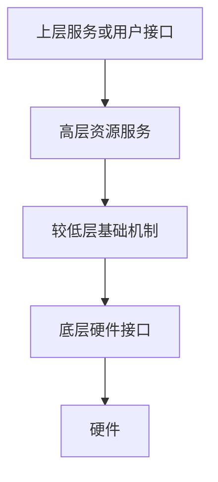
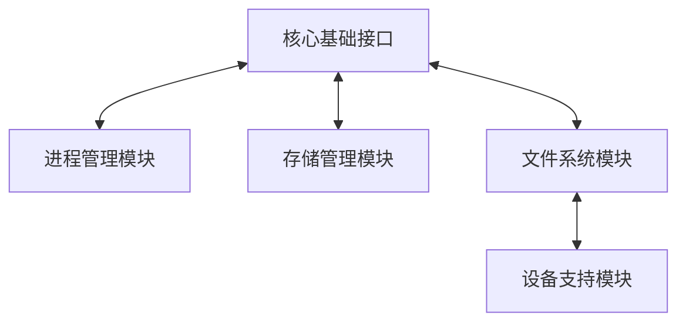
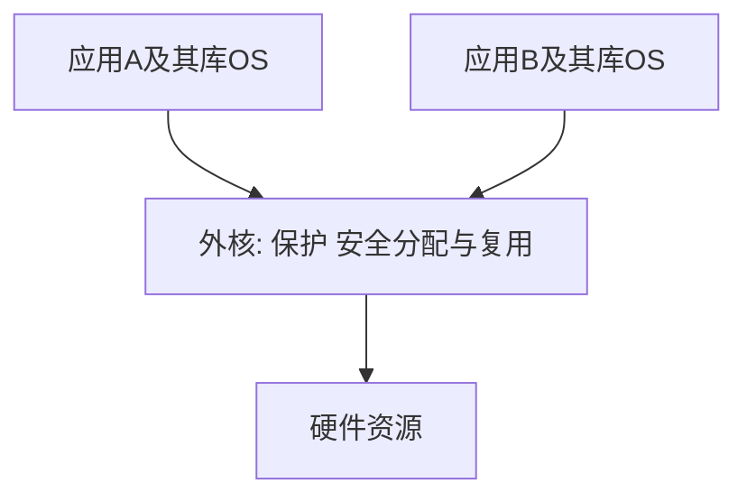

# 分层模块化与外核

返回 [[第一章 操作系统概述]]。来源：[[操作系统第一章原图与识别说明#原图04|原图04]]、[[操作系统第一章原图与识别说明#原图05|原图05]]。

## 分层结构
严格分层模型中，上层通过规定接口使用下层服务。照片限定“只调用紧邻下一层”，是一种较严格的层次设计；有些分层系统允许使用多个更低层接口，不能把邻层限制当全部实现的共同规定。

优点：便于自底向上设计、验证和维护，接口职责清晰。难点：层次边界和依赖不容易划分；严格逐层调用可能增加路径与开销。

## 补充分层图：严格邻层调用示例

这里只画服务依赖方向；返回方向省略，不代表函数无法返回。

## 模块化
按功能划分模块和子模块，规定接口与依赖关系。可并行开发、局部维护，并在系统支持时动态加载或卸载部分内核模块。

模块化是一种组织方式，可用于大内核，也可与分层结合，不是与两者互斥的独立硬件运行状态。

## 补充模块图：通过明确接口协作

不是任意模块可无条件调用任意模块。符号、版本、锁、初始化次序和模块引用都可能限制依赖；正在使用的模块也不保证可以安全卸载。

可加载模块进入内核后仍可能运行在内核态。直接模块调用有利于减少消息传递开销，但隔离性不能由“模块”二字自动获得。

## 外核（Exokernel）
外核强调把资源保护与高层管理策略分离：底层安全地复用硬件资源，应用级库OS等在授权范围内建立所需抽象。

原图“分配不虚拟、不抽象的资源”宜理解为尽量暴露低层资源、避免强制统一高层抽象，不是应用能跳过权限和隔离随意访问硬件。

## 补充外核图：保护与抽象分工

潜在优势是应用可选择更合适的资源抽象，减少不合适的统一层次开销；代价是库OS和应用承担更多管理责任、实现与兼容性更复杂。具体物理页或资源绑定不普遍要求全部连续、永久固定。

参考：[MIT Exokernel原项目介绍](https://pdos.csail.mit.edu/archive/exo/)。

关联：[[大内核微内核与原语]]、[[虚拟性与异步性]]、[[虚拟机与两类VMM]]。
