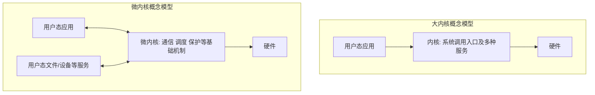

# 大内核微内核与原语

返回 [[第一章 操作系统概述]]。来源：[[操作系统第一章原图与识别说明#原图03|原图03]]、[[操作系统第一章原图与识别说明#原图05|原图05]]、[[操作系统第一章原图与识别说明#原图13|原图13]]、[[操作系统第一章原图与识别说明#原图14|原图14]]。

## 内核与内核外软件
内核是承担核心资源控制和保护机制的部分，运行于相应特权状态。命令解释器、系统工具、部分服务可位于用户态；“操作系统提供的功能”不等于“这些功能全部在内核内实现”。

## 大内核/宏内核
把较多OS服务放入内核空间，进程、存储、文件、设备等功能可直接通过内核内部接口协作。常见优势是直接调用路径较短；风险是可信代码与故障影响范围较大。

大内核可以有清晰的模块化设计和可加载模块，不能把它必然说成毫无结构、无法维护。一个内核模块出错可能破坏整个内核，但并非每个错误都必然整机崩溃。

## 微内核
把内核保留得较小，将许多高层服务放到用户态服务器，以IPC等机制协作。内核通常还需要基本线程/调度、地址空间或保护机制、通信和中断支持，具体集合依设计，不是只剩“时钟管理+中断+原语”三个固定功能。

优点常是隔离边界清楚、便于服务拆分与维护；跨地址空间通信、权限切换和调度可能带来额外成本。不能由“微”直接推出所有场景必慢，性能还取决于实现与工作负载。

## 补充结构图：功能放在哪个边界

在“应用→内核→用户态服务器→内核→应用”的简化请求应答路径中，可发生4次用户/内核边界切换；直接内核服务可示意为进入、返回2次。但请求结构、缓存和具体实现可改变次数，不能机械记成每个服务永远2或4次。

## 原语
本课原语是具有原子性要求的底层操作抽象，可能由多条机器指令实现。“一气呵成”强调不能出现破坏该操作语义的交错，不等于所有内核函数都不能被中断。

单核教材可用短暂关中断保护某些操作；多核下还需要原子指令、锁等协调，关本CPU中断不能自动阻止其他核访问同一共享数据。具体原语和同步实现留到后续章节。

## 微内核设计相关思想
原图13列出精简内核、客户/服务器模式、机制与策略分离和面向对象。这些可作为常见设计思想或相关技术，不能把某种编程范式当作所有微内核必须满足的定义条件。

参考：[seL4参考手册，Kernel Services and Objects](https://sel4.systems/Info/Docs/seL4-manual-12.1.0.pdf)。

关联：[[分层模块化与外核]]、[[系统调用与库函数]]、[[用户态内核态与特权指令]]。
