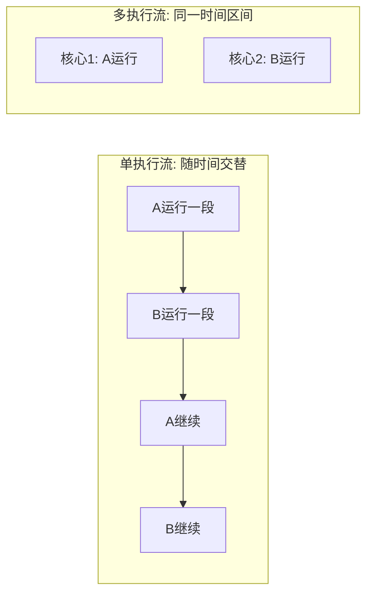

# 并发并行与资源共享

返回 [[第一章 操作系统概述]]。来源：[[操作系统第一章原图与识别说明#原图09|原图09]]、[[操作系统第一章原图与识别说明#原图12|原图12]]。

## 并发与并行
并发：多个活动在同一时间区间内都有进展，未必同一瞬间执行。并行：多个活动在同一时刻实际同时执行。

在本章“单核、单硬件执行流”的简化CPU模型中，多个进程通过交替运行形成并发；多个核心可让不同活动并行。多核并不保证任意程序自动并行，还需任务可分配并有足够资源。本章暂不细分硬件多线程等实现。

## 补充图：交替进展与同时执行

图中多核两个框表示允许同时运行，不代表相同指令数或等长耗时。并发是程序组织与进展关系，并行还需要实际执行资源。

## 资源共享的两种教材方式
互斥共享：资源可供多个进程先后使用，但某段使用期间只允许一个进程占有，例如按独占作业方式分配的打印设备。共享不等于同时占有。

同时访问共享：允许多个进程在一段时间内交错访问或并行利用，未必同一纳秒访问同一物理部件。照片以磁盘为例，应理解为支持多个进程的访问请求，单磁头或共享通路仍可能串行服务。

## 并发与共享的关系
并发使资源共享有意义；共享的资源又需要调度和协调，才能让并发活动正确使用。互斥解决不该同时进入的问题，同步约束必要的先后关系，详细方法留到后续章节。

补充例：两个进程都需要打印机，可先后各完成一份打印任务；两者是共享该设备，并非必须把两份文档逐字符混合打印。

关联：[[虚拟性与异步性]]、[[硬件多线程与多核]]、[[总线传输过程与使用权]]、[[操作系统的发展与分类]]。
