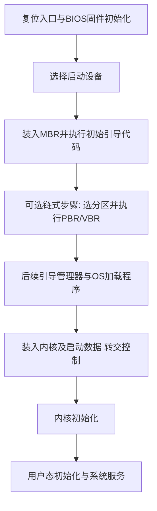
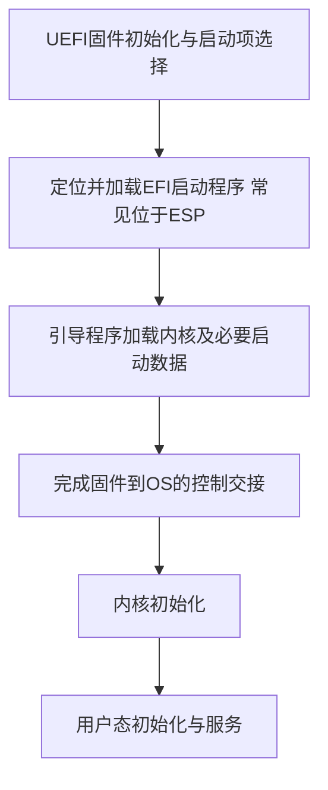

# 操作系统引导与启动

返回 [[第一章 操作系统概述]]。来源：[[操作系统第一章原图与识别说明#原图05|原图05]]、[[操作系统第一章原图与识别说明#原图08|原图08]]。

## 引导要解决什么
开机时还没有正常运行的OS，需要由固件和引导程序逐步建立环境、装入内核，并把控制权交给内核。固件、引导管理器、OS加载程序、内核初始化、用户态初始化程序是不同角色，不能统称为“根目录中的完整初始化程序”。

固件通常持久保存于ROM/Flash等介质，并映射到处理器可访问的地址空间；执行时也可能复制代码到RAM。不要把固件和“已经装入RAM的OS”混为同一层。

## 原图的传统BIOS/MBR模型
1. CPU复位后从架构规定的入口开始执行固件，完成必要硬件初始化/自检等。
2. BIOS选择启动设备，装入并执行磁盘MBR中的初始引导代码；MBR还包含传统分区表。
3. 初始代码选择合适分区，常见链式启动可再执行PBR/VBR（分区/卷引导记录），继续定位后续引导程序。
4. 引导管理器/加载程序依据配置装入OS内核和必要启动数据，转交控制权。
5. 内核初始化关键子系统，随后启动用户态初始化进程和其他服务。

## 补充流程图：传统链式启动示意

这是照片所用的典型传统模型，不代表每个引导器必须逐个经过同名阶段，也不要求OS和引导器都放在C盘根目录。

## 补充：UEFI启动的基本区别
UEFI固件有自身启动管理机制，可按启动项定位EFI系统分区等位置的EFI加载程序；常见UEFI+GPT方案不依赖执行传统MBR引导代码。UEFI不等于所有介质只能用GPT，具体支持还受平台规则影响。

## 补充流程图：常见UEFI本地磁盘启动

本章只需抓住固件→引导程序→内核→用户态服务，具体安全启动、文件路径和扇区格式暂不展开。

参考：[Oracle官方UEFI启动说明](https://docs.oracle.com/en/operating-systems/oracle-linux/8/boot/boot-AboutUEFIBasedBooting.html)、[UEFI规范：Boot Services与控制交接](https://uefi.org/specs/UEFI/2.9_A/07_Services_Boot_Services.html)。

关联：[[ROM与Flash存储器]]、[[磁盘结构与性能计算]]、[[操作系统的概念功能与接口]]。
