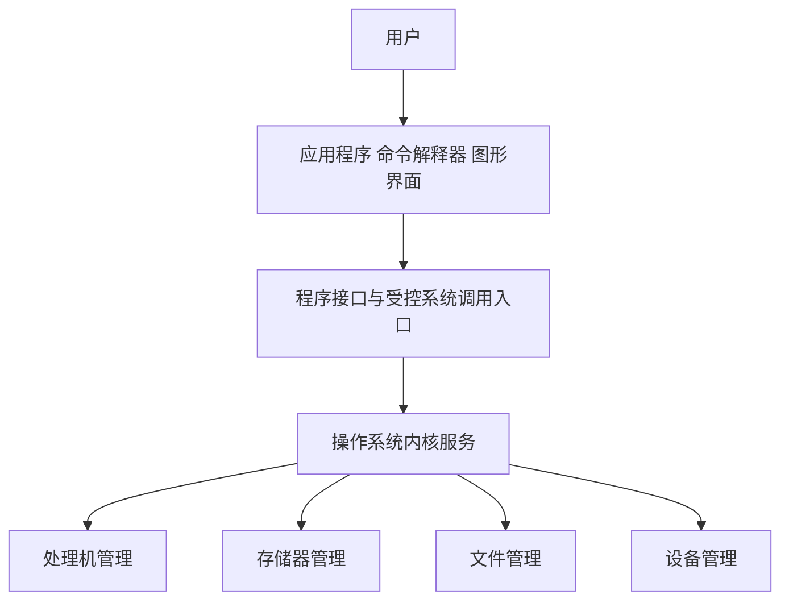

# 操作系统的概念功能与接口

返回 [[第一章 操作系统概述]]。来源：[[操作系统第一章原图与识别说明#原图11|原图11]]、[[操作系统第一章原图与识别说明#原图12|原图12]]、[[操作系统第一章原图与识别说明#原图14|原图14]]。

## 操作系统是什么
操作系统是计算机系统中管理硬件和软件资源、组织程序运行、分配资源并提供服务环境的基本系统软件。理解时抓住三个角度：资源管理者、服务提供者、对硬件机器的扩充。

## 四类管理与目标
- 处理机管理：组织进程/线程运行，分配CPU时间。
- 存储器管理：分配和回收内存，提供地址空间与保护等。
- 文件管理：组织文件、目录及相关访问。
- 设备管理：控制设备、协调I/O与分配使用权。

目标常包括方便、有效、可靠、安全及可扩展等，具体系统在吞吐、响应、公平、时限等方面有不同取舍，不是任何目标都能同时达到最好。

## 用户使用系统的接口
命令接口面向用户：联机/交互式逐步发出命令，脱机/批处理方式预先组织作业控制信息。GUI也是面向用户的交互形式；不是只有Windows才有命令或批处理接口。

程序接口面向程序：通过系统调用等请求内核服务。普通用户经应用程序间接使用这些能力。“广义指令”是某些教材对系统调用的称呼，不代表一条普通函数调用就自动升到内核态。

## 补充图：从使用者到资源

框图是服务关系，命令解释器、GUI及不少系统工具可运行在用户态，不能把整个操作系统软件集合全当作内核代码。

## 扩充机器与虚拟机的两种语境
裸机指没有软件支持的硬件机器；软件提供更方便的功能和抽象后，教材可称“扩充机器”或广义虚拟机。它不等于一定存在Hypervisor，也不等于已经运行多个客体操作系统。

本章后半“虚拟机”专指提供虚拟硬件环境、可运行客体OS的系统级虚拟机，见 [[虚拟机与两类VMM]]。

四个基本特征：并发、共享、虚拟、异步。其中并发与共享是教材强调的两个最基本特征，分见 [[并发并行与资源共享]]、[[虚拟性与异步性]]。

关联：[[软件语言与系统层次]]、[[计算机系统与冯诺依曼结构]]、[[系统调用与库函数]]。
