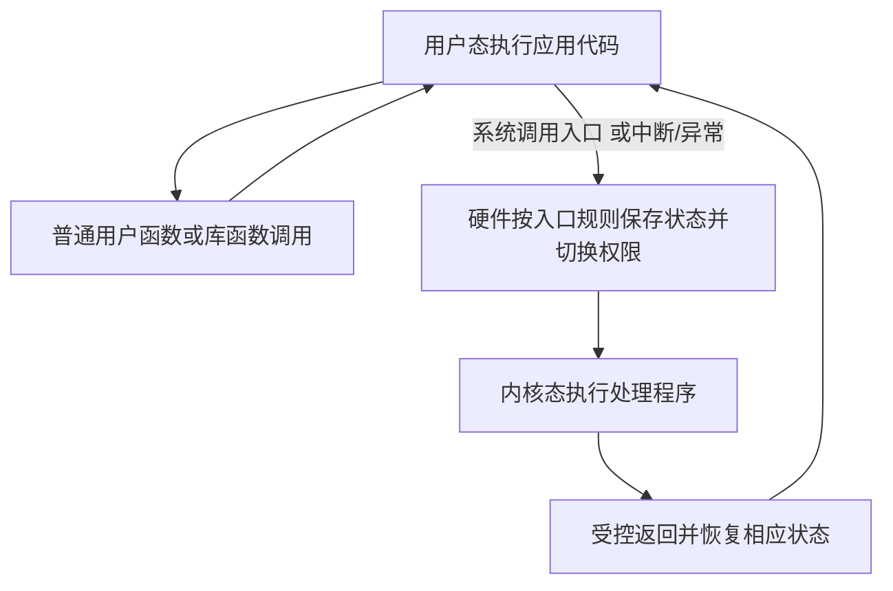

# 用户态内核态与特权指令

返回 [[第一章 操作系统概述]]。来源：[[操作系统第一章原图与识别说明#原图01|原图01]]、[[操作系统第一章原图与识别说明#原图03|原图03]]、[[操作系统第一章原图与识别说明#原图14|原图14]]。

## 两种运行状态
内核态又称核心态、管态；用户态又称目态。它们首先是CPU当前权限状态，不是“程序名字里带内核”就自动得到的权限。

本章采用两态简化模型：用户态不能直接执行受限制的特权操作；内核态可以执行这些操作，也能执行普通运算、访存等非特权指令。

修改关键控制状态、管理受保护资源等操作受到硬件权限检查。特权指令集合依体系结构，不把所有CPU和平台的细节混为一表。

## PSW标志位的约定
照片用PSW中某位1表示内核态、0表示用户态，这是教材约定，不是所有CPU共同编码。x86还有CPL/Ring等机制，不能把“PSW某位=1”直接套到x86。

## 受控切换
用户态进入内核态：应用主动发系统调用，或硬件在中断/异常时转入规定入口。入口权限检查、状态保存与切换由体系结构控制；应用不能任意修改权限位来获得特权。

内核态返回用户态：内核完成相应工作后，通过受控的返回/状态恢复机制切换，不是一条用户态普通赋值语句。

## 补充图：两态切换与普通调用

图示最简单的返回原应用路径；处理程序可能阻塞、终止进程或调度其他活动，并非一定立即回到同一行代码。

## 三个不能等同
- 进入内核态不等于切换到另一个进程。
- CPU在内核态不等于它只执行特权指令。
- 内核主动让出CPU给谁是调度问题；返回用户态与分配CPU给哪个进程不是同一个动作。

原图“中断是进入内核态的唯一途径”须按教材广义中断/陷入语境理解，不能解读为必须等待一个外部I/O中断；快速系统调用指令也可实现受控入口。

关联：[[中断异常与陷入机制]]、[[系统调用与库函数]]、[[CPU功能与寄存器]]、[[中断请求响应与隐指令]]。
