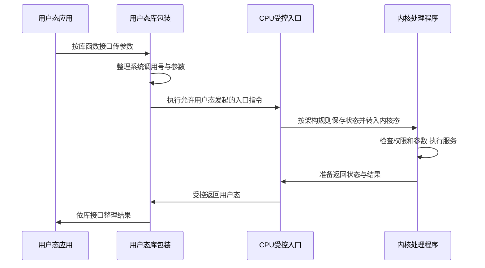

# 系统调用与库函数

返回 [[第一章 操作系统概述]]。来源：[[操作系统第一章原图与识别说明#原图03|原图03]]、[[操作系统第一章原图与识别说明#原图06|原图06]]、[[操作系统第一章原图与识别说明#原图07|原图07]]、[[操作系统第一章原图与识别说明#原图11|原图11]]。

## 系统调用是什么
操作系统向应用提供的受控服务入口，常用于文件、设备、进程、通信和内存管理。内核检查权限和参数后完成相应操作，避免应用任意操纵全局资源。

系统调用不是一个普通用户函数本身。应用通常调用库的包装函数，由包装代码准备系统调用号和参数，再执行体系结构规定的入口指令；也可按约定直接发起调用。

## 系统调用与库函数的关系
- 普通用户态函数调用通常只转移用户态控制流，不自动改变权限。
- 许多库函数纯在用户态计算，例如一般的字符串长度计算。
- 有些库函数封装系统调用，名字相同也不代表二者完全一样。
- 一次库调用可能不触发、触发一次或多次系统调用。例如有缓冲的输出不保证每次`printf`都立即进入内核；内存分配也可能先用已有用户堆空间。

## 补充时序图：一个简单、最终返回原应用的系统调用

这是简单路径，不代表所有调用都必须经库、立即完成或立即返回同一应用；系统调用也可能阻塞、出错或终止当前进程。

## 陷入指令与执行状态
教材常称陷入/trap/访管指令。它允许用户态程序主动发起请求，因此不能把它当“只有内核态才能执行的普通特权指令”。入口指令触发受控切换，内核服务代码随后在内核态运行。

“陷入指令=trap指令=访管指令”是本课功能语境中的近义说法，不强求所有CPU有同一个助记符；现代系统调用也不必通过外部中断或同一种中断向量表。

## 常见功能分类
设备请求/释放/启动，文件创建/读写/删除，进程创建/结束/等待，进程间通信，以及内存映射/分配等。具体哪些由内核直接实现、哪些由库或用户态服务组合，依OS结构而定。

核对：[Linux man-pages：系统调用及库包装](https://www.man7.org/linux/man-pages/man2/intro.2.html)。

关联：[[用户态内核态与特权指令]]、[[中断异常与陷入机制]]、[[函数调用与栈帧]]、[[操作系统的概念功能与接口]]。
