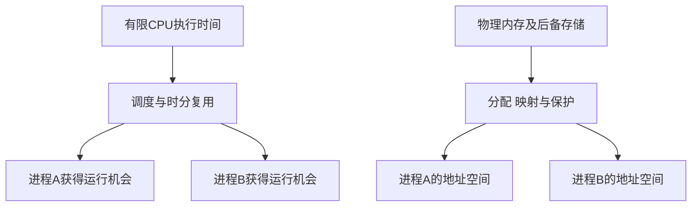

# 虚拟性与异步性

返回 [[第一章 操作系统概述]]。来源：[[操作系统第一章原图与识别说明#原图09|原图09]]、[[操作系统第一章原图与识别说明#原图12|原图12]]。

## 虚拟性
把有限物理资源通过软件和硬件机制表现为更便于使用的逻辑资源。

- 时分复用：让不同活动轮流使用资源，例如分配CPU时间，形成各程序仿佛各有处理机的体验。
- 空分复用：划分或映射空间，例如为进程建立地址空间。虚拟存储不只是把内存简单切成固定大小块；具体机制放在操作系统的存储管理章节。

逻辑资源的外观不等于物理资源凭空增加，仍受容量、带宽、调度和保护限制。不要把虚拟性全都等同于“开虚拟机”。

## 补充图：物理资源与逻辑视图

图是功能概览，不在此推导分页和地址转换算法。

## 异步性
多道程序环境中，进程可能因为调度、I/O和资源竞争走走停停，其具体推进速度和交错时刻不一定预先确定。

这里的异步性不等于“任何结果必定随机”，也不等于接口名带async。通过正确的同步和互斥，可使有依赖的活动遵守所需逻辑规则；运行时刻仍可能不同。

补充例：A等待磁盘时B先运行，磁盘完成后A进入可运行状态，但是否立即占CPU还取决于调度。I/O完成不等于A必在同一瞬间继续执行。

关联：[[并发并行与资源共享]]、[[虚拟机与两类VMM]]、[[存储层次与存储器分类]]、[[DMA控制器与传送过程]]。
