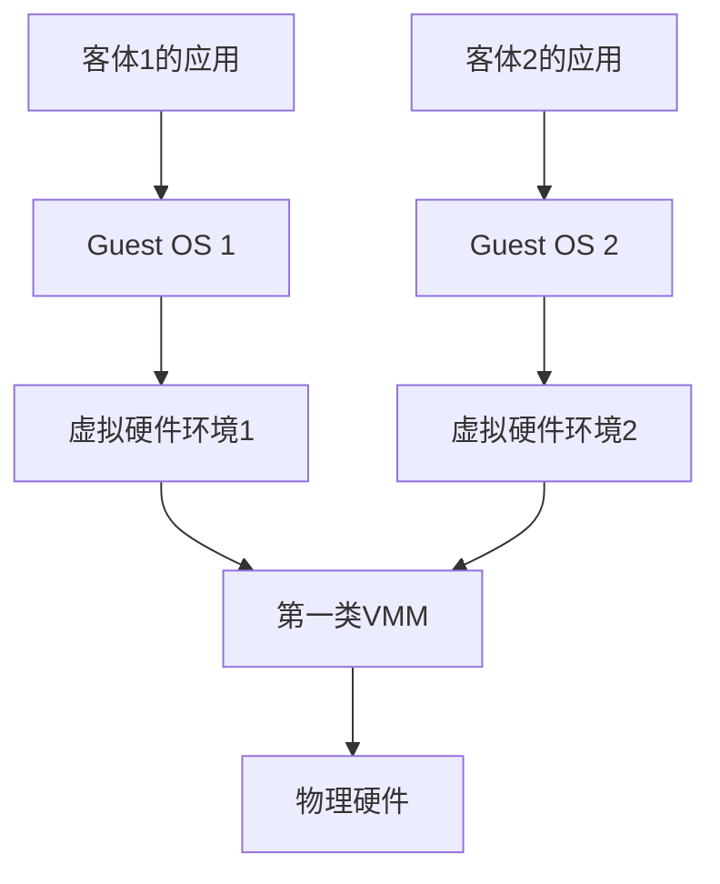
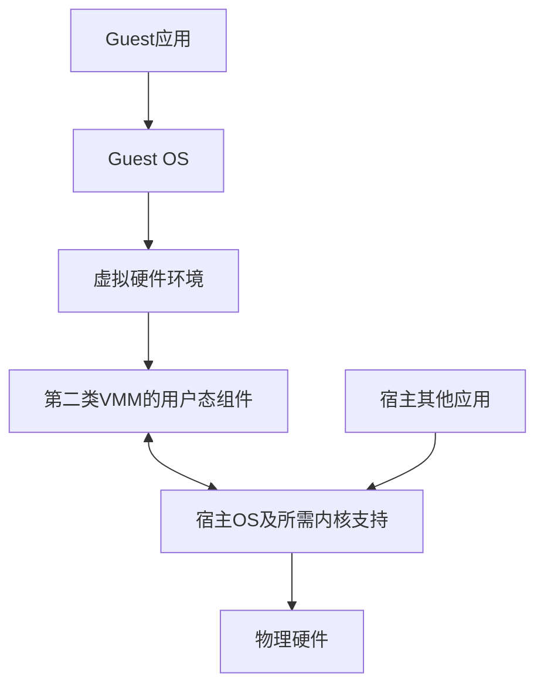

# 虚拟机与两类VMM

返回 [[第一章 操作系统概述]]。来源：[[操作系统第一章原图与识别说明#原图02|原图02]]、[[操作系统第一章原图与识别说明#原图08|原图08]]、[[操作系统第一章原图与识别说明#原图13|原图13]]。

## 系统级虚拟机
VMM（Virtual Machine Monitor）也称Hypervisor，为客体提供虚拟CPU、内存、磁盘等环境，使一台物理机上可运行多个相互隔离的系统实例。

Guest OS为客体操作系统，Host OS为宿主操作系统。VM的虚拟硬件、Guest内核和Guest应用是不同层次，不能把一台VM仅等同于一个磁盘镜像文件。

## 第一类：裸机型VMM
概念上直接管理硬件和客体，不以普通宿主OS上的应用作为主要承载层。

## 补充结构图1：第一类逻辑层次

存在管理分区或辅助服务等实际设计，图不表示所有代码都只有一个简单平面。第一类不必给每个VM永久分配互不共享的固定磁盘/CPU/内存；也可调度、动态分配或按策略复用。

## 第二类：宿主型VMM
主要运行在宿主OS提供的环境上，利用其驱动和资源服务；实际通常可能有用户态组件、内核驱动及硬件辅助。

## 补充结构图2：第二类概念模型

箭头是功能依赖，不代表每条Guest指令都逐层调用软件，也不表示所有虚拟化代码只在宿主用户态。

## 性能与可维护性怎么比较
教材常把第一类描述为控制路径直接、适合集中运行VM，把第二类描述为易利用宿主环境、便于安装使用和搬移。它们是常见倾向，不能无条件推出同一硬件上第一类必然更快、VM数量一定更多、第二类一定更易迁移。

实际还依硬件辅助、驱动、存储与网络路径、内存策略及负载；虚拟磁盘可以是宿主文件，也可以用其他后端。镜像搬移还需格式、架构和设备兼容，复制一个文件不保证任意宿主可运行。

## Guest内核态不等于Host用户态
Guest有自己的用户/内核权限关系；硬件虚拟化还区分客体与监控器的运行环境。不能把全部Guest代码统一标成真实CPU的用户态，也不能仅用Ring0至Ring3的一条轴完整描述现代虚拟化。

原图13“Guest OS发出的系统调用都会被VMM截获并转为Host系统调用”需要纠正：Guest应用的系统调用一般先由Guest内核处理；只有相关受监控操作、设备访问等才按实现触发虚拟化介入，后续可能使用宿主服务，并非逐个系统调用一对一翻译。

参考：[Linux KVM官方接口说明](https://www.kernel.org/doc/html/v5.14/virt/kvm/api.html)展示用户态管理与内核运行客体的配合，只用作概念对照，不在此给混合实现强贴唯一类型标签。

关联：[[用户态内核态与特权指令]]、[[系统调用与库函数]]、[[虚拟性与异步性]]、[[操作系统的概念功能与接口]]。
