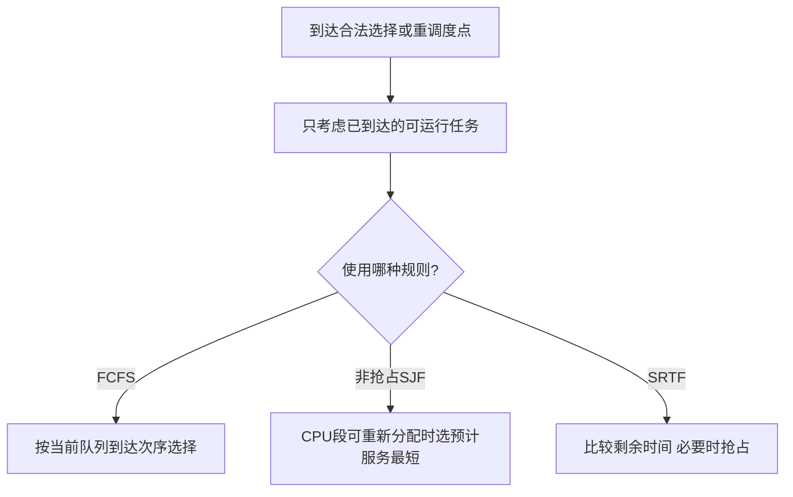

# FCFS与短作业短剩余时间优先

返回 [[第二章 进程管理]]。来源：[[操作系统第二章原图与识别说明#原图08|原图08]]、[[操作系统第二章原图与识别说明#原图17|原图17]]、[[操作系统第二章原图与识别说明#原图30|原图30]]。

## FCFS先来先服务
按进入对应队列的先后服务：作业调度看后备队列，CPU调度看就绪队列。运行的CPU段不因后来者到达而被抢占，先到的长CPU段可能使后面的短任务等待很久，形成护航/车队效应。

优点是简单、到达次序清楚；有限且能结束的前序任务下，后续任务可得到服务，不因不断插入短任务而被永久越过。它不保证短任务响应或平均周转最好。

## SJF/SPF
选择当前已到达、符合条件的最短预计服务任务。SJF常指短作业优先，进程CPU调度语境也称SPF；本批默认非抢占版本。

不能选择还没到达的未来短任务。遇到新任务也不立即抢走当前非抢占CPU段，需等完成/阻塞等选择点。

## SRTF/STCF
抢占式最短剩余时间优先：出现新就绪者等事件时，比较可运行任务的剩余CPU服务时间；必要时暂停原任务。比较的是**当前剩余量**，不是原始总长度。

## 补充选择流程

## 最优性和饥饿的条件
在所有任务同时就绪、只用CPU、已知服务量、忽略开销等条件下，SJF可得到最小平均等待/周转。不能脱离到达和抢占模型，说任意SJF都对任何指标全局最优；平均带权周转也需单独核算。

持续到来的短任务可能让长任务长期得不到服务，产生饥饿；实际服务时间往往只能估计。SRTF也不是只看新进程“总运行时间”就能做题。

核对：[OSTEP：Scheduling Introduction](https://pages.cs.wisc.edu/~remzi/OSTEP/cpu-sched.pdf)，其中STCF对应本批SRTF语境。

关联：[[处理机调度补充算例]]、[[调度性能指标与计算]]、[[高响应比优先与饥饿]]。
