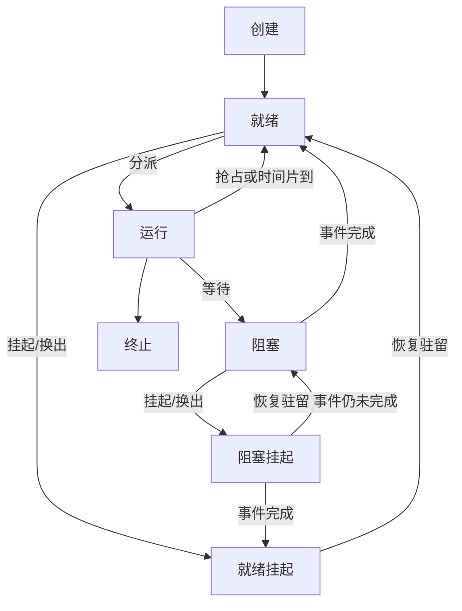

# 三级调度与挂起状态

返回 [[第二章 进程管理]]。来源：[[操作系统第二章原图与识别说明#原图21|原图21]]、[[操作系统第二章原图与识别说明#原图29|原图29]]。

## 三种调度关注不同资源
高级/作业调度：从后备作业中选择并接纳，建立其运行条件；在传统批处理模型中每个作业接纳一次，不是每次CPU分配都重新做作业调度。

中级/内存调度：决定暂时移出与恢复哪些进程的驻留工作，缓解内存压力。课本用整进程换出/换入解释，实际系统也可能使用更细粒度内存管理，并不都存在同样的“整进程交换队列”。

低级/处理机调度：从可运行实体中选择并分配执行机会，通常最频繁。若系统支持内核线程，调度实体通常进一步细化为内核可见线程等。

常见频率关系是低级高于中级、高级，不把“每几十毫秒必调度一次”当固定规定。

## 挂起与阻塞
阻塞维度：等待事件，条件尚不满足。挂起维度：在本章模型里暂时不驻留/不被接纳为可直接执行；二者可同时存在。

就绪挂起：事件条件已满足，但还需恢复驻留。阻塞挂起：既等事件又未恢复驻留。故阻塞挂起的事件完成后，应先变为就绪挂起，不能立即运行；把它换入但事件未完成则回到驻留阻塞。

## 补充七状态图

为清楚起见，运行中挂起等可复合路径没有全画；按题给七状态模型判断。这里的“挂起”也不直接等同于Unix的SIGSTOP停止状态。

关联：[[进程状态与PCB队列]]、[[调度时机抢占与分派]]、[[虚拟性与异步性]]。
