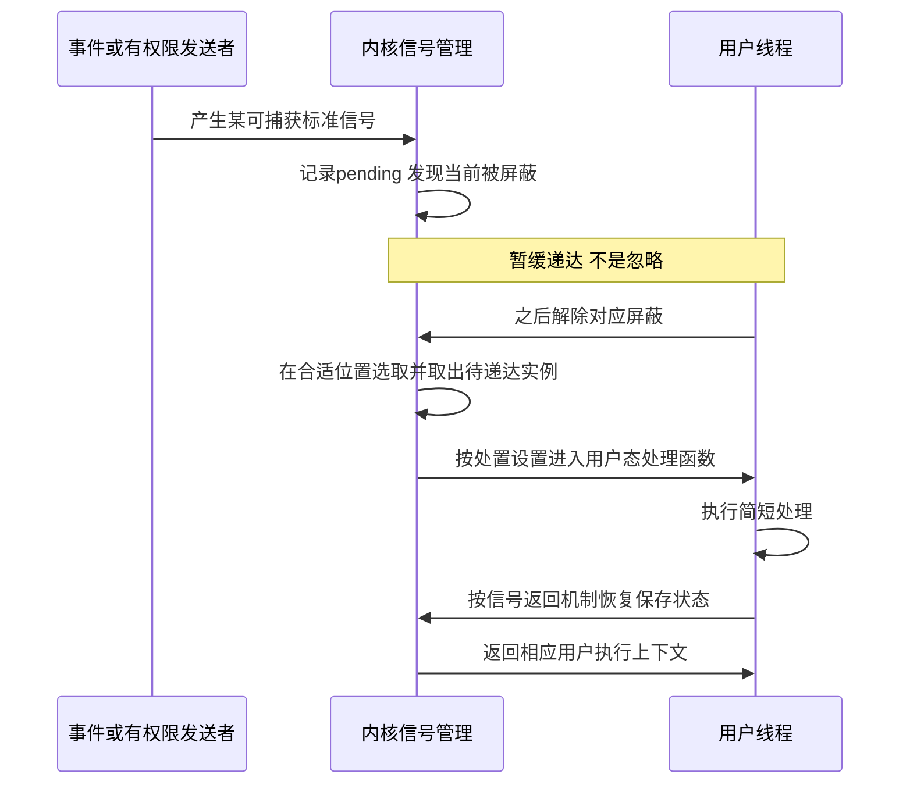

# 信号的产生屏蔽与处理

返回 [[第二章 进程管理]]。来源：[[操作系统第二章原图与识别说明#原图02|原图02]]、[[操作系统第二章原图与识别说明#原图12|原图12]]、[[操作系统第二章原图与识别说明#原图16|原图16]]。

## 信号通知与发送
信号用于通知事件、请求特定动作，也可配合异常处理。不同OS的信号集合和编号不同，优先使用SIGINT等符号名。

照片的`kill(pid,sig)`是发送信号接口，名称不表示每次都终止进程；需要满足权限。核对：[kill(2)](https://man7.org/linux/man-pages/man2/kill.2.html)。

## pending与blocked
教学位图模型：pending位表示该类型尚待处理，blocked位表示暂缓递达。`pending AND NOT blocked`可表示可考虑递达的类型集合；屏蔽不是忽略，也不意味着事件完全没发生。

实际多线程系统区分进程级和线程级待处理集合，信号屏蔽字通常按线程维护；信号处置方式通常由进程共享。不要把一张进程PCB中的两条位图当作Linux全部实现。

## 标准信号与实时信号
标准信号在同类已pending时通常合并，不记录每次发生次数；不同标准信号的递达顺序不能可移植地按编号升序假定。实时信号可排队，并有规定的顺序规则。

位图本身不含来源，不等于系统绝不能提供来源；相应接口可用siginfo信息报告适用的发送者等元数据。

## 递达与处理
Linux常在返回用户态等合适位置安排递达。默认处置可为终止、忽略、停止、继续等；捕获时执行进程设置的用户态处理函数。**用户信号处理函数不是内核中断服务程序**。

## 补充时序图：被屏蔽的可捕获标准信号

这里只画可捕获且最终返回的情形。不能把“处理函数结束后再无条件清pending位”当实现规范，否则可能错误删除处理期间新到的信号。

SIGKILL、SIGSTOP不能捕获、屏蔽或忽略。信号处理函数还有可调用操作的限制，不能把它当任意普通函数环境；具体编程规则不在本批展开。

## 与CPU异常的区别
缺页等异常可由内核修复而不向应用递达信号；某些无法完成的操作可由OS转成信号交给进程。但CPU异常类型、中断向量和Unix信号编号是不同概念，处理后也不保证总是从“下一条指令”继续。

核对：[Linux signal(7)](https://man7.org/linux/man-pages/man7/signal.7.html)。

关联：[[中断异常与陷入机制]]、[[系统调用与库函数]]、[[线程概念资源与TCB]]、[[共享存储与消息传递]]。
