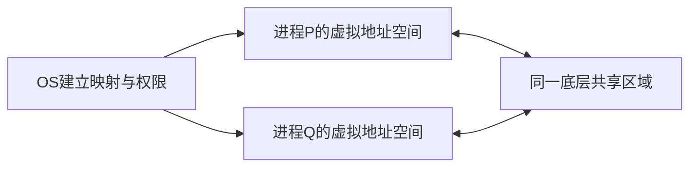
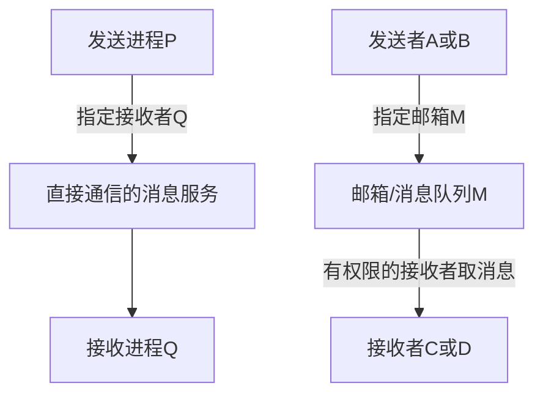

# 共享存储与消息传递

返回 [[第二章 进程管理]]。来源：[[操作系统第二章原图与识别说明#原图01|原图01]]、[[操作系统第二章原图与识别说明#原图06|原图06]]、[[操作系统第二章原图与识别说明#原图26|原图26]]。

## 进程通信与地址空间
IPC是进程间信息交换。独立地址空间提供隔离，但可通过OS授权显式共享同一底层存储，不能说不同进程的任何内存内容都永久不可共享。

## 共享存储
OS建立共享区域及映射，进程之后可通过各自地址访问该区域。各进程映射的虚拟地址不必相同；共享访问不代表每次普通读写都要通过系统调用复制。

建立映射、权限和生命周期仍需系统管理；数据访问次序、互斥与可见性也需按协作规则保证。具体同步算法留到后续学习。

## 补充共享存储图

照片区分基于数据结构共享与基于存储区共享，教材可按操作抽象程度称低级/高级；这不是单凭速度快慢或“使用共享内存”即可统一定级。

## 消息传递
信息以消息组织，通过发送/接收接口交换。消息可分头和体，但发送者PID、接收者PID、长度是否都在实际用户消息头里，是具体接口设计，不是每个OS都统一规定。

直接通信：发送或接收操作显式指明对方身份。间接通信：经邮箱/消息队列等对象交换，不必在发送时指定最终接收者。

## 补充消息图：指定对方与指定邮箱

`send(Q,msg)`、`receive(P,msg)`、`send(M,msg)`等是本课抽象原语，不是统一可直接编译的真实API。是否复制消息、队列放在哪、是否阻塞和如何唤醒，都依具体实现。

邮箱可有多个生产者/消费者，但要规定竞争接收规则；不等于一条消息自动广播给所有接收者。

关联：[[管道通信与阻塞条件]]、[[信号的产生屏蔽与处理]]、[[并发并行与资源共享]]。
