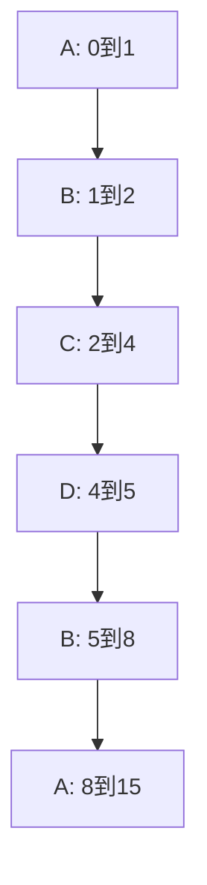

# 处理机调度补充算例

返回 [[第二章 进程管理]]。来源：[[操作系统第二章原图与识别说明#原图03|原图03]]、[[操作系统第二章原图与识别说明#原图08|原图08]]、[[操作系统第二章原图与识别说明#原图10|原图10]]、[[操作系统第二章原图与识别说明#原图17|原图17]]、[[操作系统第二章原图与识别说明#原图30|原图30]]、[[操作系统第二章原图与识别说明#原图31|原图31]]。

## 统一题设（整理时补充）
单CPU，时间单位ms，只有CPU服务、无I/O和切换开销；进程按A/B/C/D标识。同一时刻先处理新到达，再让耗尽时间片者回队尾。SRTF剩余量相同则保持当前运行者，其他并列按到达再按标识。

```text
进程    到达A    CPU服务S
A       0       8
B       1       4
C       2       2
D       3       1
```

RR时间片q=2 ms；HRRN采用非抢占版本。以下不是原图中缺失题干的复原。

## 五种算法的完整结果
### FCFS

执行区间（左闭右开）：`A[0,8) → B[8,12) → C[12,14) → D[14,15)`。

- A：完成8，周转8，等待0，首次响应0；带权周转1。
- B：完成12，周转11，等待7，首次响应7；带权周转11/4。
- C：完成14，周转12，等待10，首次响应10；带权周转6。
- D：完成15，周转12，等待11，首次响应11；带权周转12。

平均周转：43/4 ms；平均等待：7 ms；平均首次响应：7 ms；平均带权周转：87/16（无量纲）。

### SJF

执行区间（左闭右开）：`A[0,8) → D[8,9) → C[9,11) → B[11,15)`。

- A：完成8，周转8，等待0，首次响应0；带权周转1。
- B：完成15，周转14，等待10，首次响应10；带权周转7/2。
- C：完成11，周转9，等待7，首次响应7；带权周转9/2。
- D：完成9，周转6，等待5，首次响应5；带权周转6。

平均周转：37/4 ms；平均等待：11/2 ms；平均首次响应：11/2 ms；平均带权周转：15/4（无量纲）。

### SRTF

执行区间（左闭右开）：`A[0,1) → B[1,2) → C[2,4) → D[4,5) → B[5,8) → A[8,15)`。

- A：完成15，周转15，等待7，首次响应0；带权周转15/8。
- B：完成8，周转7，等待3，首次响应0；带权周转7/4。
- C：完成4，周转2，等待0，首次响应0；带权周转1。
- D：完成5，周转2，等待1，首次响应1；带权周转2。

平均周转：13/2 ms；平均等待：11/4 ms；平均首次响应：1/4 ms；平均带权周转：53/32（无量纲）。

### HRRN

执行区间（左闭右开）：`A[0,8) → D[8,9) → C[9,11) → B[11,15)`。

- A：完成8，周转8，等待0，首次响应0；带权周转1。
- B：完成15，周转14，等待10，首次响应10；带权周转7/2。
- C：完成11，周转9，等待7，首次响应7；带权周转9/2。
- D：完成9，周转6，等待5，首次响应5；带权周转6。

平均周转：37/4 ms；平均等待：11/2 ms；平均首次响应：11/2 ms；平均带权周转：15/4（无量纲）。

### RR

执行区间（左闭右开）：`A[0,2) → B[2,4) → C[4,6) → A[6,8) → D[8,9) → B[9,11) → A[11,15)`。

- A：完成15，周转15，等待7，首次响应0；带权周转15/8。
- B：完成11，周转10，等待6，首次响应1；带权周转5/2。
- C：完成6，周转4，等待2，首次响应2；带权周转2。
- D：完成9，周转6，等待5，首次响应5；带权周转6。

平均周转：35/4 ms；平均等待：5 ms；平均首次响应：2 ms；平均带权周转：99/32（无量纲）。

## 补充时间线：SRTF为什么这样切换


t=3时C剩1、D服务1，同值按题设保留C；不能凭新到就强行抢占。t=4之后D完成再选B，A虽然最早到达，剩余服务仍更长。

RR最后A在11到15独占，但13仍有时间片边界；因为没有其他候选而继续选A，区间合并不代表把q改成4。

本例HRRN和SJF碰巧相同，不说明两种算法等价；HRRN每次还要考虑已等待时间。所有结果均已通过逐单位时间模拟核对。

关联：[[调度性能指标与计算]]、[[FCFS与短作业短剩余时间优先]]、[[高响应比优先与饥饿]]、[[时间片轮转与优先级调度]]。

