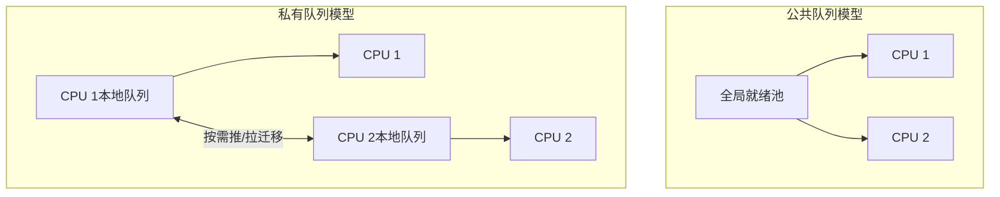

# 多处理机调度负载均衡与亲和性

返回 [[第二章 进程管理]]。来源：[[操作系统第二章原图与识别说明#原图05|原图05]]、[[操作系统第二章原图与识别说明#原图19|原图19]]。

## 多了一个“放在哪个处理器”
单执行流调度主要选下一个任务；多处理机还要选择任务放在哪个可用CPU执行资源上。此处实际可调度实体可为线程，不必坚持全是单线程进程。

两个常见目标：负载均衡，让可用CPU少闲置；处理器亲和性，尽量复用缓存等已有状态。二者可能冲突，需要权衡迁移和访问开销。

## 公共与私有就绪队列
公共队列：多个CPU从同一池中取任务，比较容易共享负载，但队列访问需要同步，也可能增加迁移和竞争。

私有队列：每CPU有本地队列，便于维持局部性，但负载可能不均，需配合迁移策略。它只是有利于亲和，不保证从来不迁移。

## 补充图：两种队列组织

同一个线程不能被两个CPU重复同时出队执行；同进程内不同可运行线程则可能分到不同核。公共队列访问同步的具体算法留到后续学习。

## push与pull
推迁移：负载管理者或较忙CPU将可迁移任务推给较空CPU。拉迁移：较空CPU从其他队列取合格任务。可结合使用，不保证所有任务都允许移动。

## 软亲和与硬亲和
软亲和：调度器尽量维持原CPU，但允许权衡后迁移。硬亲和：受约束的CPU集合；集合可以只有一个CPU，也可以多个，不必总固定到唯一CPU。

不能为了均衡无视亲和性限制、优先级和任务可运行条件。性能收益还依缓存及共享资源，不在此展开Cache映射或替换算法。

参考：[OSTEP：Multiprocessor Scheduling](https://pages.cs.wisc.edu/~remzi/OSTEP/cpu-sched-multi.pdf)。

关联：[[用户级内核级线程与多线程模型]]、[[调度时机抢占与分派]]、[[Cache局部性与平均访问时间]]、[[硬件多线程与多核]]。
