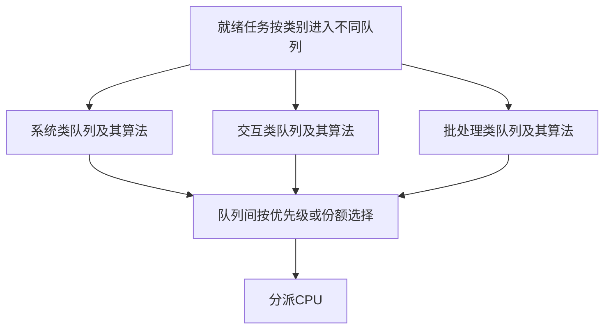
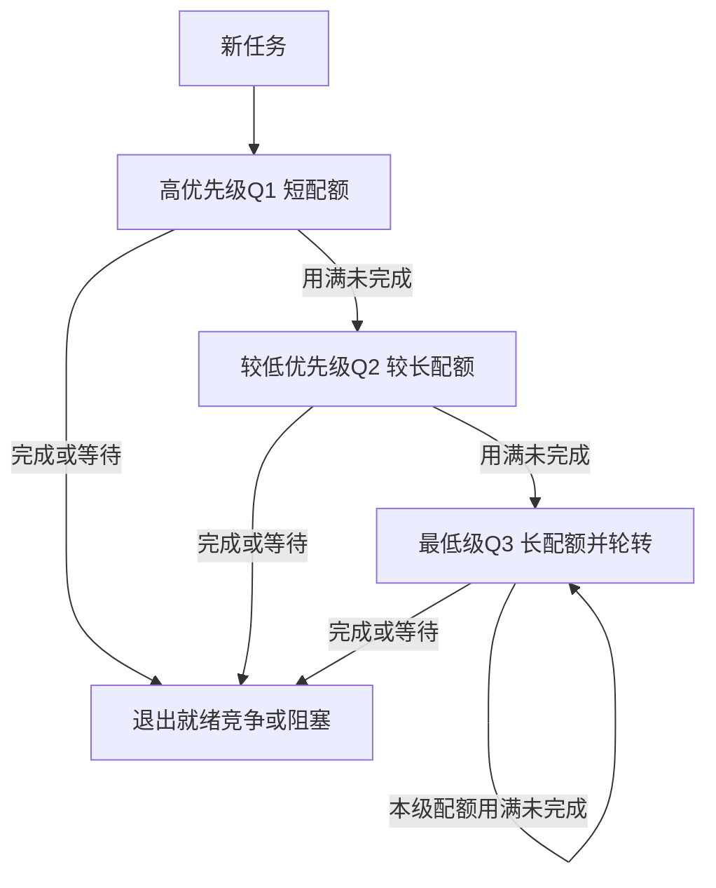

# 多级队列与多级反馈队列

返回 [[第二章 进程管理]]。来源：[[操作系统第二章原图与识别说明#原图05|原图05]]、[[操作系统第二章原图与识别说明#原图09|原图09]]、[[操作系统第二章原图与识别说明#原图33|原图33]]。

## 多级队列MLQ
按进程类别等建立多个就绪队列，任务通常固定归类；各队列内可使用不同算法，队列之间再按固定优先级或时间份额分配。

原图例子：系统队列用优先级、交互队列用RR、批处理队列用FCFS；另给50%/40%/10%的份额只是示例，不是通用配置。

## 补充图1：队列内与队列间是两层选择

## 多级反馈队列MLFQ
队列同时表示不同处理优先级，任务能根据运行表现跨队列移动。以下为照片使用的典型模型：
1. 新到任务进入最高级队尾。
2. 总是优先服务更高的非空队列，通常同级轮转。
3. 高级队列时间配额较短，低级较长；用完该级配额未完成则下降一级，最低级继续轮转。
4. 高级任务变就绪可在允许点抢占低级任务。

## 补充图2：反馈的关键是运行后迁移

高队列抢占是调度规则，图中迁移箭头表示配额耗尽降级，两者不能混为一事。照片将被高级队列抢占者放回原队尾；其他实现可保留剩余配额/队列位置，必须按题目指定。

I/O后回哪一级、配额是否累计、同时事件先后和是否周期性提升也要明确。照片给“因I/O阻塞可暂时放回原队列”作为扩展，不能自行变成每次都升到最高。

## 优点与风险
能依据历史运行而非预先给定总时长调整偏好，兼顾短任务、交互与长任务；但不保证任何负载下完全公平，也可产生低级任务饥饿。老化/周期提升是常见补充改善思路。

MLQ按类别分组、通常不反馈迁移；MLFQ按行为调整层级，这才是关键差别，不是只看有没有多个队列。

参考：[OSTEP：MLFQ](https://pages.cs.wisc.edu/~remzi/OSTEP/cpu-sched-mlfq.pdf)，其具体规则可能比本课图更完整，读题先用题定模型。

关联：[[时间片轮转与优先级调度]]、[[高响应比优先与饥饿]]、[[多处理机调度负载均衡与亲和性]]。
