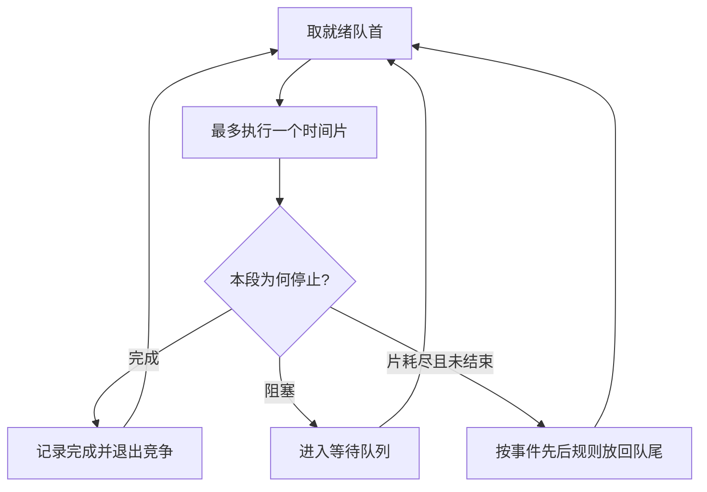

# 时间片轮转与优先级调度

返回 [[第二章 进程管理]]。来源：[[操作系统第二章原图与识别说明#原图03|原图03]]、[[操作系统第二章原图与识别说明#原图09|原图09]]、[[操作系统第二章原图与识别说明#原图27|原图27]]、[[操作系统第二章原图与识别说明#原图31|原图31]]。

## RR时间片轮转
对当前就绪队列轮流分配时间片q。用满仍未结束则回到队尾；提前完成或阻塞则提前让出CPU。单纯RR中新到任务通常进队尾，不因到达就立刻抢占尚未用完片的任务。

同一时刻“时间片耗尽重排”和“新任务到达”的入队先后会改变结果。原图31约定新到先入队，做题可采用，但必须以完整题干为准。

## 补充流程图

就绪队列为空时进入空闲等路径，图略。若只有当前任务可运行，片到也可继续选中自身，不必硬做一次不同任务切换。

q过大时，在特定无I/O工作负载上可退化为FCFS；q过小会增加切换成本。“一般不超过1%”是照片的设计经验，不是所有系统必须满足的规范。

补充：若每运行q发生一次耗时s的切换，稳态简化开销占比为s/(q+s)。要该比值≤1%，需q≥99s；若题目把分母定义为有效执行q，则按s/q计算。

## 优先级调度
从合格候选中选最高优先级者，可抢占也可非抢占；静态优先级不随普通运行情况改变，动态优先级可按等待、资源使用等调整。

数字大是高还是低必须读题；同级先后也需明确。就绪队列改变时，抢占策略才在允许点检查是否应该换人。

教材常安排系统、前台、I/O密集任务较高，是设计倾向而非所有OS统一顺序。I/O密集任务CPU段短，优先运行可较早重新启动I/O，有时能改善资源重叠，但仍需兼顾公平和时限。

持续高优先级负载可能饿死低优先级任务；老化等动态提升策略可改善。不能把“支持优先级”直接等同于已满足实时截止期限。

关联：[[处理机调度补充算例]]、[[高响应比优先与饥饿]]、[[多级队列与多级反馈队列]]、[[操作系统的发展与分类]]。
