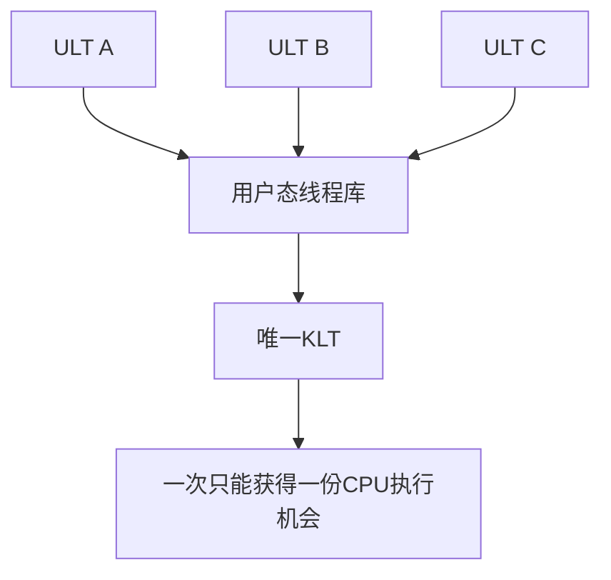
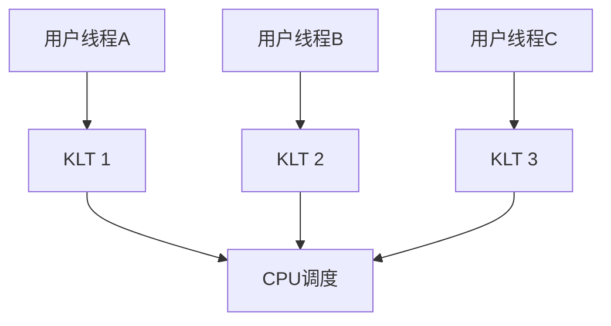
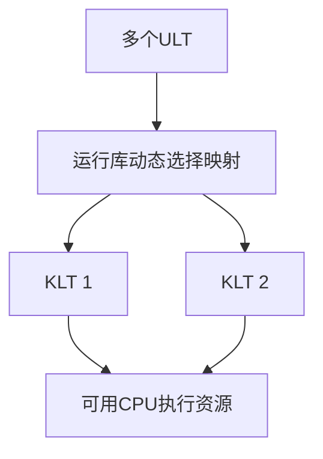

# 用户级内核级线程与多线程模型

返回 [[第二章 进程管理]]。来源：[[操作系统第二章原图与识别说明#原图22|原图22]]、[[操作系统第二章原图与识别说明#原图24|原图24]]、[[操作系统第二章原图与识别说明#原图28|原图28]]。

## 两个层次
用户级线程ULT：运行库管理的逻辑执行流，切换可在用户态完成，内核不必直接认识每个ULT。内核级/内核可见线程KLT：由内核记录、调度的执行实体；它不只指纯内核工作线程，也可承载用户代码。

下图用KLT表示内核调度机会，不表示CPU只执行内核代码；映射是教材模型，实际运行库可更复杂。

## 多对一
多个ULT映射到一个KLT，内核最多同时调度这一份执行资源。管理较轻，但不能让这些ULT跨多个核心同时执行。

## 补充图1：多对一

若唯一KLT因阻塞系统调用睡眠，全部映射ULT都暂时失去执行载体。但一个ULT仅在运行库里等待、运行库能切到其他ULT时，不必让整个进程阻塞；“任一ULT等待就全阻塞”过于绝对。

## 一对一
每个用户线程对应一个KLT，某个KLT阻塞时其他可运行KLT仍能运行；有资源时可跨核并行，创建管理及内核调度成本较高。

## 补充图2：一对一

## 多对多
N个ULT复用M个KLT，教材常取N≥M。运行库管理逻辑线程，内核调度KLT，兼顾ULT数量与并行载体数量。

## 补充图3：多对多

并行度上限受可运行ULT、可用KLT及可用CPU执行资源共同限制；M个KLT不等于任何时刻必有M个线程正在运行。

ULT内部切换可能不变态；涉及内核调度的KLT切换需要内核支持。不能把一种模型的阻塞、并行和开销结论直接套给另外两种。

关联：[[线程概念资源与TCB]]、[[调度时机抢占与分派]]、[[用户态内核态与特权指令]]、[[多处理机调度负载均衡与亲和性]]。
