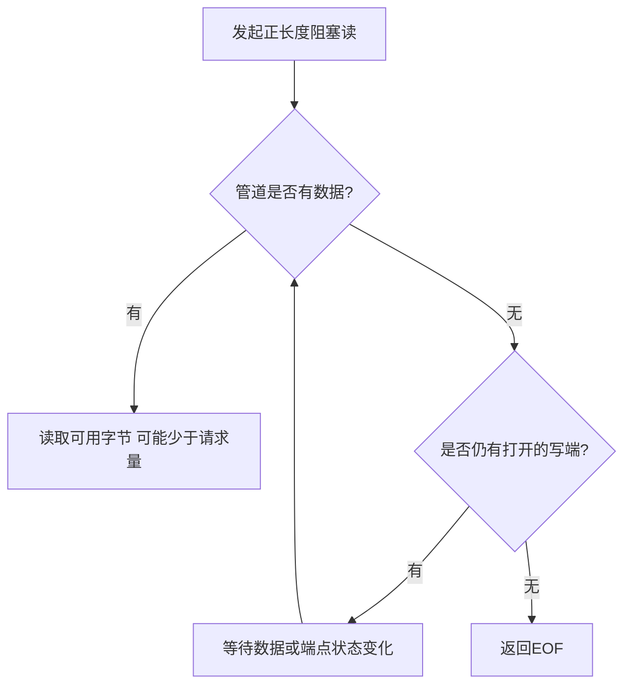

# 管道通信与阻塞条件

返回 [[第二章 进程管理]]。来源：[[操作系统第二章原图与识别说明#原图01|原图01]]。

## 字节流与方向
本课普通管道是有限容量的字节流通道，写入先后决定读取先后，读走的数据不再供后续读取。不能随机seek，也不保留一写一读的消息边界；大请求可能只读到一部分。

传统可移植模型按单向通信处理。双向独立通信通常建两条管道，不能由“半双工”推出随时可把同一普通管道的固定读写端互换。

容量有限，但不宜记成所有管道都固定同一大小，实际可依系统和配置变化。

## 核心条件：不必等到全满或全空
- 有数据就可尝试读，不要求写满才读。
- 有足够空间完成当前写入要求就可推进，不要求先读空整条管道。
- 空且仍有写端存在：阻塞读可等待；空且所有写端都关闭：读返回EOF。
- 空间不足：阻塞写可能等待；非阻塞模式可能报告暂时不可用或部分完成，依请求规则。
- 所有读端都关闭：写会出现断管错误/信号，而非一直等待读者。

## 补充图：普通阻塞读的分支

图为正常管道条件，省略信号中断、取消等其他返回原因。

## 多读者、多写者
照片“一条管道只能一个读进程”是可用于题目的简化约束，不是Linux普遍限制。多读者会竞争消费，不是都得到相同副本；应用需自行设计数据分配。

内核保证规定范围内写入的原子性，例如符合PIPE_BUF限制的写不与其他写者交错；这不等于任意长度写都原子，也不代表内核替应用确定全部业务顺序。PIPE_BUF与总容量不是同一概念。

核对：[Linux pipe(7)](https://man7.org/linux/man-pages/man7/pipe.7.html)。

关联：[[共享存储与消息传递]]、[[进程状态与PCB队列]]、[[信号的产生屏蔽与处理]]。
