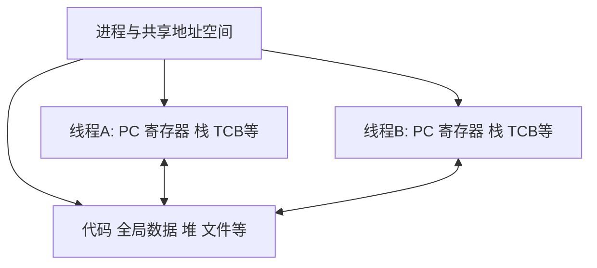

# 线程概念资源与TCB

返回 [[第二章 进程管理]]。来源：[[操作系统第二章原图与识别说明#原图04|原图04]]、[[操作系统第二章原图与识别说明#原图12|原图12]]、[[操作系统第二章原图与识别说明#原图28|原图28]]。

## 引入线程后的分工
传统单线程进程把资源身份与执行流合在一起；引入线程后，进程通常作为地址空间和资源的拥有/分配单位，线程作为更细的执行流和调度单位。

“线程不拥有资源”要理解为通常不独立拥有整个进程地址空间等资源，不能说线程没有任何私有状态。

## 共享什么、各自保留什么
同进程线程通常共享代码、全局数据、堆、打开的文件等进程资源。每个线程保留自己的PC/寄存器状态、栈、线程标识、执行状态等。

各自有栈不意味着同进程中栈之间天然有硬件安全隔离；共享地址空间使协作方便，也使错误与数据竞争可能相互影响。通信可通过普通内存访问，但仍需正确同步。

## 补充结构图：一个资源容器、多个执行状态

TCB是线程控制块的教材名称，可记录标识、运行状态、优先级、寄存器与栈指针等；可组织线程表或队列。真实OS数据结构和标识范围不完全相同。

## 线程状态与调度
线程也可抽象为就绪、运行、阻塞。等待条件满足一般先就绪，再被选择运行。一个线程阻塞不一定意味着整个多线程进程没有可运行线程，须结合映射模型。

内核支持的用户线程可以在用户态执行应用代码；“由内核调度”不是“线程的所有代码只能在内核态运行”。

## 切换开销
同进程内线程切换通常保留地址空间，不等于完全没有现场保存、运行库或内核调度开销。跨进程线程切换还可能涉及地址空间等变化，通常更重；具体成本依实现。

参考：[Linux pthreads(7)](https://man7.org/linux/man-pages/man7/pthreads.7.html)。

关联：[[用户级内核级线程与多线程模型]]、[[进程概念与PCB]]、[[进程控制与上下文切换]]、[[进程状态与PCB队列]]。
