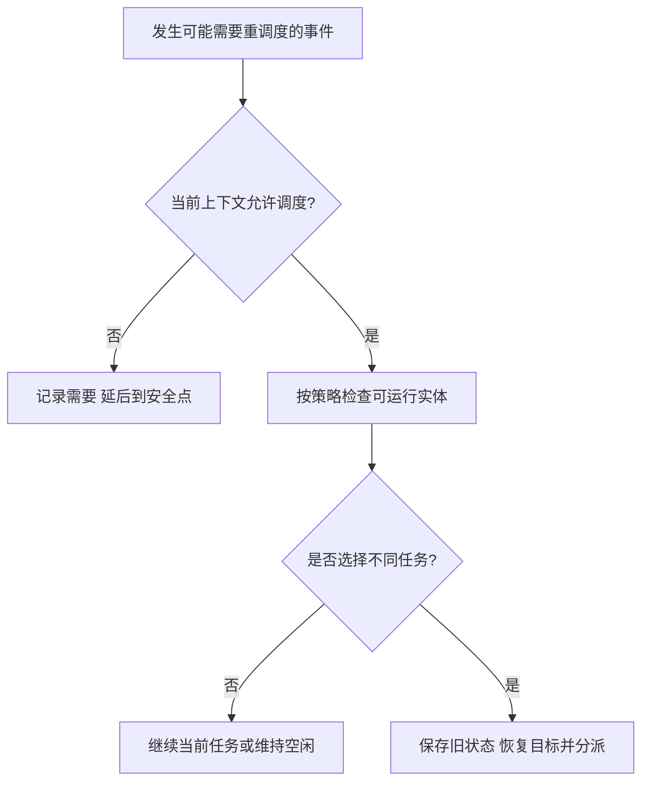

# 调度时机抢占与分派

返回 [[第二章 进程管理]]。来源：[[操作系统第二章原图与识别说明#原图14|原图14]]、[[操作系统第二章原图与识别说明#原图15|原图15]]、[[操作系统第二章原图与识别说明#原图20|原图20]]、[[操作系统第二章原图与识别说明#原图26|原图26]]、[[操作系统第二章原图与识别说明#原图29|原图29]]。

## 选择与切换是两步
狭义调度：从符合条件的就绪实体中选择目标。分派/切换：把执行机会和相应运行状态交给目标。一次选择可能仍是当前任务，所以调度不必等于两个不同进程之间切换。

没有内核线程时，教材以进程为调度对象；支持内核线程时，内核实际可按KLT等更细实体调度，进程则主要承载资源身份。

## 典型触发事件
当前任务完成、终止或阻塞；新任务到达或被唤醒；时间片耗尽；优先级变化等。事件只提供重新考虑的机会，是否抢占还依策略与当前上下文。

非抢占：在本课普通CPU调度模型中，当前CPU段继续到完成或阻塞等让出点，新到高优先级任务不直接夺走CPU。它不意味着硬件中断和强制终止从此不能发生。

抢占：在允许边界可因时间片或更高优先级等原因暂停当前任务，将其放回合适状态后分派其他任务。

## 补充决策图

## 不可随意调度的上下文
教材列出普通硬中断处理、需要保持原子性的内核关键更新、某些禁止抢占区域。中断退出后可在合适点考虑调度，不是每个I/O中断都必须当场在处理中切进程。

“在临界区不能调度”须限定：用户程序持有某资源锁仍可能被抢占或因其他原因等待；现代内核中的所有临界区也不都具有完全相同的抢占规则。关键在具体上下文和锁/原子约束。

## 闲逛/空闲任务
没有普通可运行任务时，系统可运行idle任务作为后备。照片的“执行0地址指令、完整指令周期”是极简示意，不是实际OS规定；可使用低功耗等待。统计CPU利用率时，空闲任务被安排执行不自动算作有效忙碌。

关联：[[进程控制与上下文切换]]、[[三级调度与挂起状态]]、[[时间片轮转与优先级调度]]、[[中断请求响应与隐指令]]。
