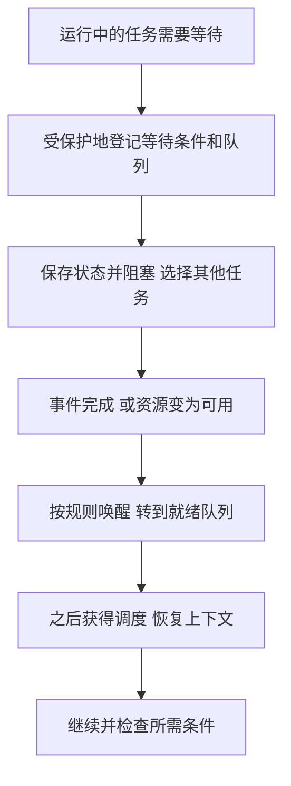

# 进程控制与上下文切换

返回 [[第二章 进程管理]]。来源：[[操作系统第二章原图与识别说明#原图07|原图07]]、[[操作系统第二章原图与识别说明#原图15|原图15]]、[[操作系统第二章原图与识别说明#原图20|原图20]]、[[操作系统第二章原图与识别说明#原图25|原图25]]、[[操作系统第二章原图与识别说明#原图26|原图26]]。

## 控制原语与一致性
创建、终止、阻塞、唤醒和切换都要协调控制记录、队列与资源。所谓原语的原子性，是不允许出现破坏该操作语义的交错；并非所有内核代码都永远不能被中断。

照片以开/关中断说明保护手段，适合简化单核模型；多核还需锁或硬件原子操作等。关本CPU中断不能独自保护全部其他核心。

## 创建
申请控制记录→分配或建立所需资源→初始化PCB→按接纳规则进入就绪等队列。资源不足时还可能失败或等待，不是发请求就无条件成功。

登录、作业接纳、显式创建子进程、系统服务需求都可能产生进程；但普通系统调用不一定每次都创建一个新服务进程，很多服务在当前调用上下文或现有工作线程内完成。

## 终止
记录原因、停止后续执行、释放/移交相关资源，并按系统规则保留或回收控制信息。是否连同子进程终止取决于系统政策；照片已注明“不一定”，保留这一限制。不能把所有资源都机械交回父进程。

## 阻塞与唤醒
阻塞：保存需要的上下文、登记等待原因，更新状态并加入等待队列，让出执行机会。唤醒：事件满足时将等待者转入就绪队列，之后仍需调度。

## 补充流程图：等待、就绪和再次运行

登记等待与条件检查须避免丢失唤醒。图不要求一次事件恰好只唤醒一个任务，也不保证唤醒即立即抢占。

## 上下文切换
保存旧任务的寄存器/PC/状态等→更新相应队列→选择目标→恢复目标上下文；必要时还切换地址空间及相关控制信息。存在代价，但数值取决于实现和缓存状态。

同进程线程切换一般不用换地址空间，仍要保存/恢复线程执行状态；内核可见线程的切换由内核参与，用户级运行库的内部切换则可能在用户态完成。

一次调度决策可选中原任务而不发生不同任务切换；进入内核处理一次系统调用也不必发生进程切换。

关联：[[大内核微内核与原语]]、[[用户态内核态与特权指令]]、[[进程状态与PCB队列]]、[[调度时机抢占与分派]]。
