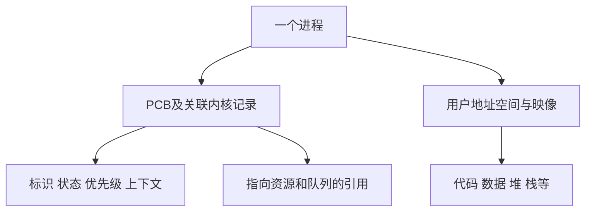

# 进程概念与PCB

返回 [[第二章 进程管理]]。来源：[[操作系统第二章原图与识别说明#原图13|原图13]]、[[操作系统第二章原图与识别说明#原图23|原图23]]、[[操作系统第二章原图与识别说明#原图32|原图32]]。

## 程序、进程与进程映像
程序是静态的指令和相关数据描述；进程是程序的一次执行活动。同一个可执行程序可形成多个具有不同状态和资源关系的进程。

教材进程映像/实体由PCB、程序段、数据段等组成，用来描述某一时刻的状态；实际还涉及栈、堆和地址映射等。进程是动态执行过程，映像是其状态描述，不应把“静态映像”理解成内存内容永远不变化。

## PCB记录什么
- 标识与关系：PID、所属用户、父子等信息。
- 控制与调度：状态、优先级、CPU使用等。
- 资源信息：内存映射、文件/设备等引用。
- 执行上下文：保存/恢复运行所需的PC、状态和寄存器等，具体实现也可能放在关联结构中。

“PCB是进程存在的唯一标志”是教材强调内核需要控制记录的表述，不是PCB就是用户程序里的一个变量。PCB一般属于内核管理数据，不要求与用户程序段在内存中连续相邻，也不要求所有管理信息都直接嵌在一个结构里。

PID在相应标识范围和生命周期内用于区分进程；进程结束后编号可以复用，不是全历史永久唯一。不同进程可共享只读代码或显式共享区域，不能由“独立进程”推出所有物理页都绝不共享。

## 补充结构图：资源与执行状态的控制记录

框图是逻辑组成，不表示PCB和应用数据共用一片可任意读写的内存。

## 五个常见特征
动态性：产生、变化和结束，是与静态程序相比的最基本区别。并发性：多个进程可在一段时间内交错推进。独立性：具备可管理的执行与资源身份，不代表不受调度或不能共享。异步性：推进速度与交错不预先确定。结构性：有程序、数据与控制信息。

异步并不必然造成错误或随机结果，正确协作还需遵守必要的同步规则。

关联：[[并发并行与资源共享]]、[[虚拟性与异步性]]、[[进程状态与PCB队列]]、[[线程概念资源与TCB]]。
