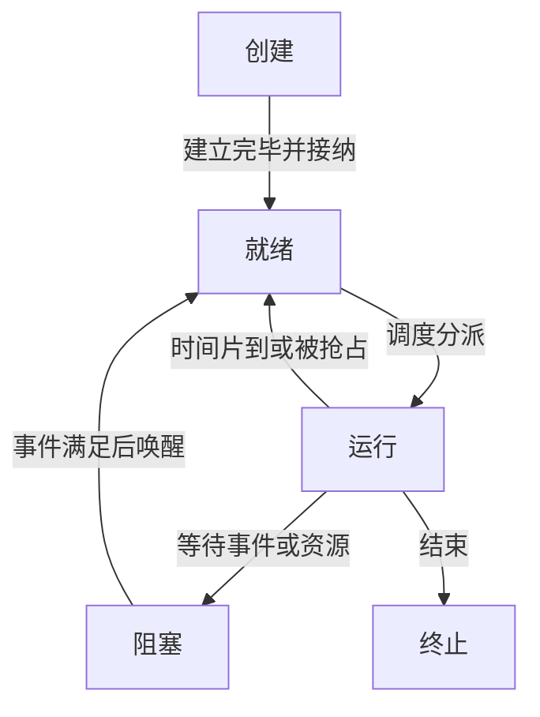
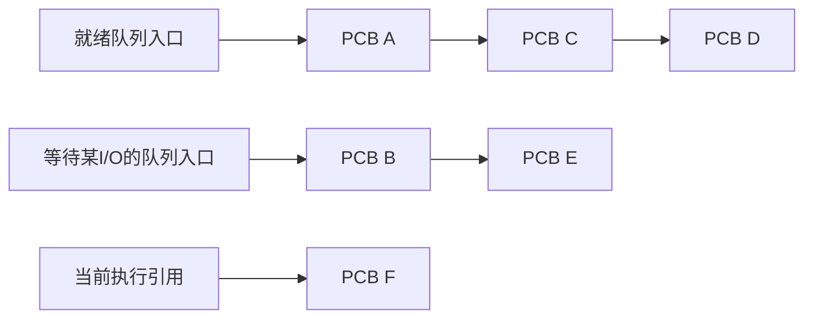

# 进程状态与PCB队列

返回 [[第二章 进程管理]]。来源：[[操作系统第二章原图与识别说明#原图11|原图11]]、[[操作系统第二章原图与识别说明#原图18|原图18]]、[[操作系统第二章原图与识别说明#原图32|原图32]]。

## 五状态模型
创建：建立必要控制记录并准备资源。就绪：具备在该模型下执行所需条件，等待CPU。运行：当前获得执行机会。阻塞/等待：还需要某事件或资源，当前不能仅靠分配CPU继续。终止：执行已结束，后续按系统规则回收。

就绪不等于“只能因为CPU完全不空闲”：调度策略也可能决定先运行别的活动。单CPU单执行流模型一次只运行一个进程，多核或多线程系统须进一步看实际调度实体。

## 补充五状态图

这是主要成功路径。终止也可能因外部请求发生于其他状态，不表示所有被终止任务都必须先回到用户态执行。

在本模型里，阻塞不能直接跳成运行，需要先满足条件成为就绪，再被调度；就绪也不会凭空变阻塞，需有对应的等待语义。运行→阻塞常由当前活动执行阻塞操作触发，但缺页等也可能由内核代为等待，不能绝对说必须由用户显式请求。

## 队列组织
链接方式：把同类PCB或其队列节点连成链；索引方式：另建索引表指向相关PCB。可按阻塞原因划分多个等待队列。

## 补充队列图

队首顺序由算法决定，不是任何就绪队列都按静态优先级排序。PCB状态值的数字编码由实现定义；队列变化与状态更新必须保持一致。

## 终止不等于全部记录立即消失
例如Linux子进程退出后可保留供父进程取得退出信息的记录，直至回收；不能把终止、资源回收和最终删除控制记录当同一瞬间。参考：[wait(2)](https://man7.org/linux/man-pages/man2/wait.2.html)。

关联：[[进程控制与上下文切换]]、[[三级调度与挂起状态]]、[[调度时机抢占与分派]]。
