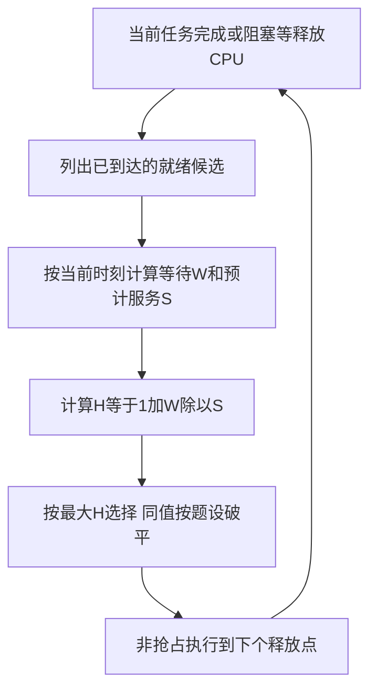

# 高响应比优先与饥饿

返回 [[第二章 进程管理]]。来源：[[操作系统第二章原图与识别说明#原图03|原图03]]、[[操作系统第二章原图与识别说明#原图08|原图08]]。

## HRRN规则
高响应比优先在每次允许重新选择时，给当前候选计算：
$$H=\frac{W+S}{S}=1+\frac{W}{S},\qquad S>0$$

W为到该选择时刻的等待时间，S为预计需要的服务时间。H≥1，取H最大的任务。它不是用户首次响应时间，也不是任务完成后才知道的带权周转。

本批为非抢占模型，不在当前任务运行途中仅因别人H变大就立刻抢占；每次重新选择时要重算，不能只在全表开始时算一次排序。

## 补充流程图

等待相同则短任务响应比更高；服务相同则等得久者更高。长任务的比值也随等待增长，缓解一味偏爱短任务的问题。

补充例：长任务W=20、S=10，H=3；短任务W=1、S=1，H=2，此时选择前者，不能凭“短”直接判后者先。

## 饥饿不是本批已学习的死锁分析
饥饿指符合运行/服务条件却长期得不到所需机会；算法偏好可造成它。教材通常把HRRN归为可避免长期饥饿的公平改进，依正常服务能结束等模型理解，不由此推出任何负载下都有固定完成时限。

FCFS的长等待也不自动等于永久饥饿；判断“很晚”和“一直得不到”需要区分。

关联：[[FCFS与短作业短剩余时间优先]]、[[时间片轮转与优先级调度]]、[[处理机调度补充算例]]、[[调度性能指标与计算]]。
